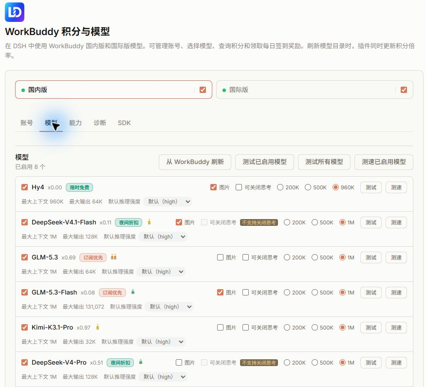

# dsh-connect-workbuddy

Use WorkBuddy CN and international models in DeepSeek Harness (DSH). The settings page lets you choose models, manage the account pool, and view credit balances.

[中文说明](README.md) · [Installation](#2-installation) · [Account pool](#4-account-pool) · [Troubleshooting](#8-troubleshooting) · [Changelog](CHANGELOG.md)



## 1. Repository and versions

This repository is a fork of [dingminhua/dsh-connect-workbuddy](https://github.com/dingminhua/dsh-connect-workbuddy).

| Source | Contents |
| --- | --- |
| `main` | Upstream code and the fork's project description |
| [workbuddy-local-integration](https://github.com/kiwaro/dsh-connect-workbuddy/tree/workbuddy-local-integration) | Changes based on 5.18.0: credits recorded for each response, account attribution during rotation, and revised Chinese messages |
| npm package `dsh-connect-workbuddy` | Releases published by the upstream author |

The response credit log is documented in [CREDIT-JOURNAL.md](https://github.com/kiwaro/dsh-connect-workbuddy/blob/workbuddy-local-integration/docs/CREDIT-JOURNAL.md).

The plugin calls WorkBuddy desktop endpoints using your account. WorkBuddy charges that account for requests.

Third-party access may lead to account restrictions or bans, and endpoint changes may interrupt service. Use is limited to personal study, research, and reasonable personal workloads, subject to WorkBuddy's terms.

## 2. Installation

### 2.1 Build the integration branch

Install Git, pnpm, and Node.js matching `^22.19.0 || >=24.0.0`. Host dependency ranges are listed in [package.json](package.json) under `peerDependencies`.

The following Windows example uses `D:/projects`. Adjust both the clone path and plugin path if you use another directory.

```sh
git clone --branch workbuddy-local-integration https://github.com/kiwaro/dsh-connect-workbuddy.git D:/projects/dsh-connect-workbuddy
cd D:/projects/dsh-connect-workbuddy
pnpm install --frozen-lockfile --ignore-scripts
pnpm run build
dsh plugin --profile desktop add D:/projects/dsh-connect-workbuddy
```

Restart DSH after installation. After changing TypeScript source files, rebuild the plugin and restart DSH.

### 2.1.1 Supported DSH versions

| DSH version | Plugin compatibility |
| --- | --- |
| 0.1.5 and earlier | Use upstream plugin 2.0.15 |
| >=0.1.7-rc.1 and <0.3.0-0 | Declared range for this branch |
| 0.3.0 and its prereleases | Requires dependency and interface review before adaptation |

### 2.2 Install an upstream release

```sh
dsh plugin --profile desktop add dsh-connect-workbuddy
```

Use the `web` profile for the web interface or `dsh-tui` for the terminal interface. Restart the corresponding DSH process after installing, updating, or removing the plugin.

### 2.3 Sign in and select models

1. Sign in to the WorkBuddy desktop app, or add an account in the plugin settings. 2. Open WorkBuddy in the DSH plugin settings and choose CN or international. 3.

   Refresh the model catalog, select models, and save. 4. Return to a conversation and choose a WorkBuddy model.

The provider IDs are `workbuddy` for CN and `workbuddy-global` for international. Each region has separate accounts, credits, and model settings.

### 2.4 Update

For the integration branch, run these commands in the repository directory:

```sh
git pull --ff-only
pnpm install --frozen-lockfile --ignore-scripts
pnpm run build
```

For an upstream release, query the version and install that exact version:

```sh
npm view dsh-connect-workbuddy version
dsh plugin --profile desktop add dsh-connect-workbuddy@<version>
dsh plugin --profile desktop exec dsh-connect-workbuddy doctor
```

Restart DSH afterward. Release-age restrictions are covered in [PINNED-UPGRADE-LAG.md](docs/PINNED-UPGRADE-LAG.md).

## 3. Accounts and models

The settings page has account, model, capability, and diagnostic sections.

| Setting | Behavior |
| --- | --- |
| CN / international switch | Adds the region's selected models to DSH; disabling it retains account and model settings |
| Refresh catalog | Updates models, credit multipliers, and promotion information |
| Model selection | Saves the models to include in the DSH model picker |
| Context budget | Sets a limit of 200K, 500K, or the model's native context window |
| Image input | Enables image input for the selected model after saving |
| Default reasoning effort | Applies when a request has no explicit effort, including summaries and conversation titles |
| Disable thinking | Offers the `off` effort level; the option is disabled if the model rejects it |
| Test | Sends a request to check model availability, charged at the model's rate |
| Speed test | Sends three short requests and reports the median output speed, charged at the model's rate |

Models and account-pool preferences have separate Save buttons. Capability switches take effect immediately.

Credit multipliers and promotion periods come from the WorkBuddy catalog. CN models can also show load indicators. Catalog availability and rates may differ between accounts; each call uses the serving account's rate.

The credit panel displays account balances. It can appear in the composer toolbar or below the composer. A sidebar entry can be enabled in the capabilities section.

## 4. Account pool

### 4.1 Members and account selection

Select accounts in the pool and save. The saved members are used for automatic routing, batch tests, and check-in.

With the pool enabled, the plugin selects an available member for each request. It may try another member after an account-related failure.

With the pool disabled, select the serving account in the account dropdown. Manual batch tests and check-in remain available in both modes.

Automatic selection compares these criteria in order, using the next criterion to break a tie:

1. Account availability.
2. Whether credits expire within three days.
3. Saved manual order.
4. Expiry time of those credits.
5. Amount of expiring credits.
6. Total credit balance.
7. Credential expiry.
8. Account ID.

Rate limits, exhausted credits, expired credentials, and connection failures can trigger failover. For a busy model, wait or choose another model. Channel-verification and parameter errors require reviewing the request.

### 4.2 Batch tests

Select accounts, save, and use the batch-test button. Set the test model and input length in the account-pool section.

If no model is specified, the plugin chooses the region's free model with the largest context window. Selecting a paid model spends credits from each tested account.

Choose an input length close to your conversation's request length. An account may pass a short test and still reject a longer conversation request.

### 4.3 Daily check-in

The plugin checks in CN personal accounts only. Select accounts, save, and use the check-in button to claim their daily rewards.

Automatic check-in is off by default. When enabled, the plugin claims rewards for saved pool members and records the day's results. Accounts already checked in are skipped for the rest of that day.

### 4.4 Account recovery

| Status | Recovery |
| --- | --- |
| Rate limited | Wait until the server's reset time; the fallback delay is 30 minutes |
| Credits exhausted | Wait for a package refresh or select another funded account |
| Connection or server failure | Eligible again after a default 30-minute delay |
| Credential rejected | Update credentials, then test the account |
| Model removed | Choose another test model and run a test |
| Account restricted | Contact WorkBuddy support; test the account after the restriction is lifted |

## 5. Image, video, and CodeBuddy CLI tools

Enable each feature in the capabilities section before use. All three are off by default.

| Feature | Entry | Billing and access |
| --- | --- | --- |
| Image generation | `workbuddy_draw_image` | Charged to an account in the authorized region |
| Video generation | `workbuddy_draw_video` | Charged when the task is submitted; the video is downloaded after completion |
| CodeBuddy CLI | `codebuddy_ask`, `/codebuddy` | Uses CodeBuddy quota and the configured workspace permissions |

Once enabled, image and video tools can be called by the conversation model. Each call is billed under WorkBuddy's rules. See [image generation](docs/IMAGE_GEN.md) and [video generation](docs/VIDEO_GEN.md) for models and parameters.

Install `@tencent-ai/codebuddy-code` before enabling CodeBuddy CLI. Set its working directory to the conversation workspace or a directory permitted by `allowedDirs`.

The default permission mode is `dontAsk`, providing read-only tools. Add `--edit` to authorize workspace edits for that command.

```text
/codebuddy
/codebuddy Review error handling in this module
/codebuddy --edit Fix the confirmed null-pointer error
```

`cliBridge.injectResult` controls whether command results are sent to the conversation model. It defaults to `true`. When the conversation is idle, sending the result causes an additional model request and token usage.

### 5.1 CLI configuration

Set these fields under `cliBridge`:

| Field | Default | Purpose |
| --- | --- | --- |
| `enabled` | `false` | Enable the tool and command |
| `binary` | Empty | Absolute CLI path; empty searches known installation paths |
| `model` | Empty | Model override; empty uses CLI settings |
| `permissionMode` | `dontAsk` | dontAsk, plan, default, auto, acceptEdits, or bypassPermissions; the last two permit edits |
| `effort` | Empty | minimal, low, medium, high, xhigh, or max |
| `maxTurns` | `10` | Turn limit, up to 100 |
| `timeoutSecs` | `900` | Timeout in seconds, up to 1800 |
| `regionOrder` | `cn,global` | Credential region order |
| `workingDir` | Empty | Default working directory |
| `allowedDirs` | Empty | Additional allowed absolute paths, comma-separated |
| `appendSystemPrompt` | Empty | Additional system prompt |
| `allowUnattended` | `false` | Allow general questions to run in a temporary directory |
| `maxReplyChars` | `60000` | Reply character limit, up to 400000 |
| `injectResult` | `true` | Send command results to the conversation model |
| `sessionContinuity` | `auto` | Resume CLI sessions; `off` starts a new session each time |
| `maxTurnsPerSessionHour` | `6` | Per-conversation hourly call limit; 0 means unlimited |
| `maxTurnsPerHour` | `20` | Per-process hourly call limit; 0 means unlimited |

## 6. Diagnostics and credentials

```sh
dsh plugin --profile desktop exec dsh-connect-workbuddy status
dsh plugin --profile desktop exec dsh-connect-workbuddy doctor
```

`status` reports sign-in status and credits. `doctor` reports the version, credential paths, device information, and host status. Both support `--json`.

The credential store saves `accessToken` and `refreshToken` in plaintext. Exported account files also contain credentials.

Restrict access using Windows ACLs or macOS/Linux file permissions. BitLocker or FileVault can provide disk encryption.

Reading encrypted WorkBuddy sign-in files requires the desktop app to obtain the key. These variables configure paths and device diagnostics:

| Variable | Purpose |
| --- | --- |
| `WORKBUDDY_AUTH_FILE` | Sign-in file path |
| `WORKBUDDY_APP_EXECUTABLE` | WorkBuddy desktop executable |
| `WORKBUDDY_TURING_SDK_DIR` | Turing Shield SDK directory; also configurable in settings |
| `WORKBUDDY_DEVICE_SDK_ENABLED` | Set to 1 or true to enable SDK calls in standalone diagnostics |
| `WORKBUDDY_DEVICE_TOKEN_FILE` | Device-token file |
| `WORKBUDDY_HEADER_TRACE` | Set to 1 to log request-header names for diagnosis |
| `WORKBUDDY_TURING_CHANNEL_ID` | SDK channel ID, default 109144 |
| `WORKBUDDY_TURING_PRODUCT_NAME` | SDK product name, default WorkBuddy |
| `WORKBUDDY_TURING_PRODUCT_VERSION` | SDK product version, default plugin version |
| `WORKBUDDY_TURING_KEYCHAIN_STORAGE` | Set to 1 to enable SDK device-cache storage |
| `WORKBUDDY_USER_HOME` | HarmonyOS user directory, default /storage/Users/currentUser |

See [Windows notes](docs/WINDOWS.md) for permissions and file locks, and [design notes](docs/DESIGN.md) for HarmonyOS and Linux credential paths.

## 6.1 Platform support

| Platform | Coverage |
| --- | --- |
| Windows | Development and regression tests cover installation paths, file locks, permissions, and subprocess startup |
| macOS | Desktop credential and application discovery; SDK token limitations are documented in the module guide |
| Linux / HarmonyOS | Credential paths follow platform conventions; check each installation with doctor |

See [Windows notes](docs/WINDOWS.md) for platform checks and [SDK notes](native/turing-sdk/README.md) for device limitations.

## 7. Development

```sh
pnpm install --frozen-lockfile --ignore-scripts
pnpm run build
pnpm run typecheck
pnpm test
pnpm run verify:entries
```

Build output is written to `lib/`. Build before running tests to include package-entry checks. After source changes, rebuild and restart the DSH process loading this directory.

Related documentation:

- [Architecture and model capabilities](docs/DESIGN.md)
- [Promotions](docs/PROMO_BADGE.md)
- [Response credit log](https://github.com/kiwaro/dsh-connect-workbuddy/blob/workbuddy-local-integration/docs/CREDIT-JOURNAL.md)
- [Windows](docs/WINDOWS.md)
- [Updates and release-age restrictions](docs/PINNED-UPGRADE-LAG.md)
- [Third-party notices](THIRD_PARTY_NOTICES.md)

## 8. Troubleshooting

| Symptom | Action |
| --- | --- |
| Empty model list | Check sign-in and the region switch, refresh the catalog, select models, and save |
| Missing entry after source installation | Build, run `verify:entries`, and restart DSH |
| Release-age restriction | Check the exact version and pnpm's `minimumReleaseAge`; see the update guide |
| `ERR_PNPM_IGNORED_BUILDS` | Review the packages and scripts named in the diagnostic log, then follow their installation instructions |
| Account settings fail to save | Check file permissions and close the process holding the configuration file |
| Sign-in file found but unreadable | Check the desktop installation path and encrypted-credential support |
| Code 11128 | Channel verification rejected the request; include the plugin version, full error, and requestId in a report |
| Code 11133 | Check model parameters and the Disable thinking option if `off` was rejected |
| Code 14003 | Wait or switch models |
| Code 11140 | Use the server's message to distinguish content-policy rejection from account restrictions; contact WorkBuddy support as needed |

## 9. Credits and license

Upstream author: LaoDing, Copyright © 2026. The code is licensed under [MIT](LICENSE). Names and trademarks belong to their respective owners.

This project is maintained independently. Tencent, WorkBuddy, and DeepSeek have neither authorized nor endorsed it.

Users bear the consequences of account restrictions, credit losses, and service interruptions. The author disclaims liability for direct or indirect losses arising from use or misuse.

| Project | License and use |
| --- | --- |
| [corrinehu/dsh-workbuddy-connect](https://github.com/corrinehu/dsh-workbuddy-connect) | MIT; credential discovery, protocol handling, model integration, and diagnostics |
| [Sliverkiss/workbuddy2api](https://github.com/Sliverkiss/workbuddy2api) | MIT; WorkBuddy protocol reference |
| [hawklithm/workbuddy2api](https://github.com/hawklithm/workbuddy2api) | MIT; source of the ported DSML parser; changes are recorded in the source and third-party notices |
| [HsiangNianian/dsh-auto-continue](https://github.com/HsiangNianian/dsh-auto-continue) | MIT; auto-continue limits and stopping rules |
| [YuJunZhiXue/dsh-purge](https://github.com/YuJunZhiXue/dsh-purge) | MIT; failure classification, message queuing, and user-message detection |
| [dingminhua/dsh-connect-trae](https://github.com/dingminhua/dsh-connect-trae) | MIT; settings cards, model management, and plugin structure |
| [dingminhua/dsh-subagent-default-model](https://github.com/dingminhua/dsh-subagent-default-model) | MIT; UI styles and bilingual text organization |
| [franksong2702/dsh-codex-connect](https://github.com/franksong2702/dsh-codex-connect) | Apache-2.0; plugin structure and provider registration |

Full attribution and license requirements are in [THIRD_PARTY_NOTICES.md](THIRD_PARTY_NOTICES.md).
