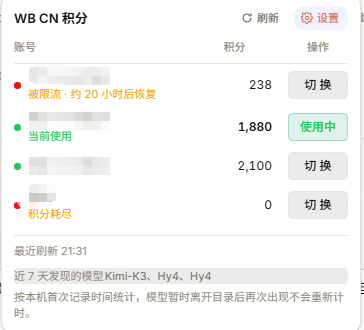
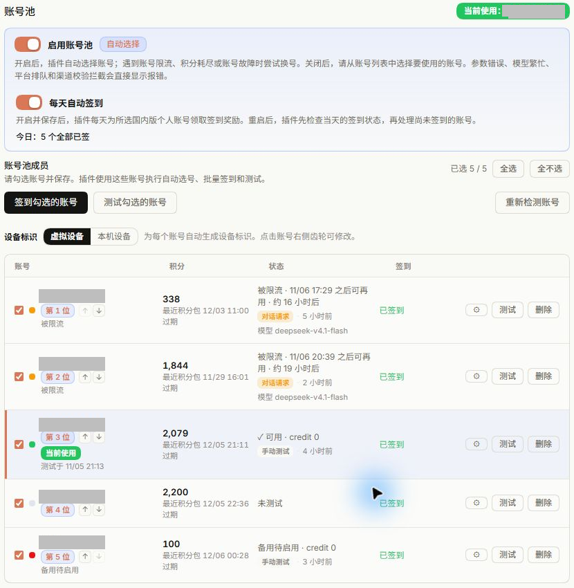
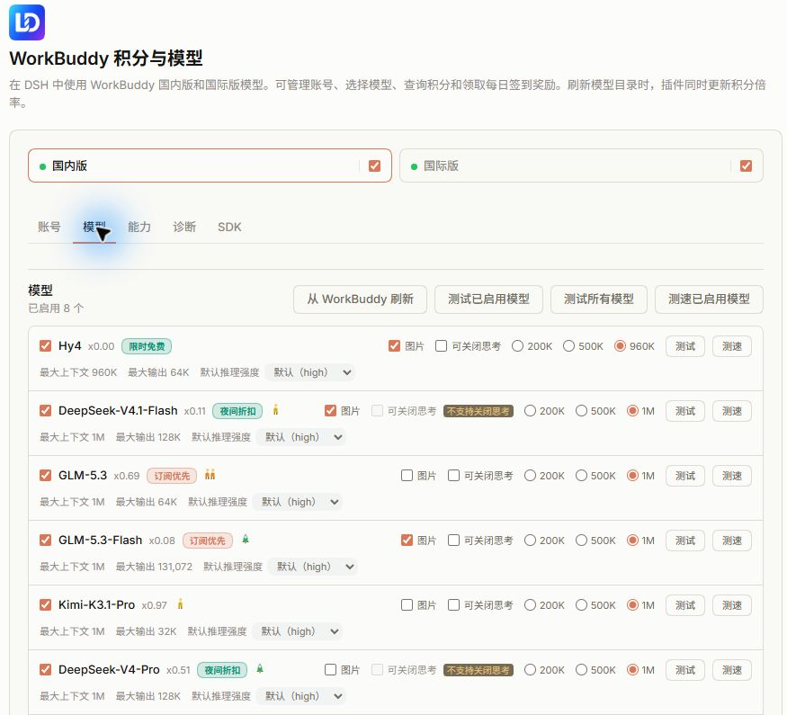
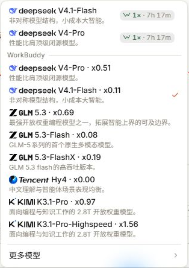

> 2026-11-09：新增五档自动刷新设置，并适配模型标签插槽；修复与验证范围见[上游合入记录](docs/UPSTREAM-INTEGRATION-2026-11-09.md)。

# dsh-connect-workbuddy

在 DeepSeek Harness 中使用 WorkBuddy 国内版和国际版模型，管理账号、模型、积分和每日签到。

[English](README.en.md) · [安装](#安装) · [界面说明](#界面与首次使用) · [账号池](#账号池) · [模型设置](#模型与推理设置) · [排障](#已知限制)

本插件将 [DeepSeek Harness（DSH）](https://github.com/deepseek-ai/deepseek-harness) 接入 WorkBuddy 国内版及国际版。两个区域分别注册为 workbuddy 和 workbuddy-global，可同时用于不同会话。账号可从已登录的 WorkBuddy 桌面端读取，也可在插件设置中通过浏览器登录。

插件可管理账号池及模型勾选，设置图片输入，并提供自动换号和每日签到。刷新模型目录时，插件读取上游给出的积分倍率；积分信息显示在设置卡片和会话输入框中。

本仓库基于上游 5.20.3 维护，修改统一保存在 main 分支。增加的响应积分记录及账号归属说明见 [积分日志](docs/CREDIT-JOURNAL.md)。npm 包由上游作者发布；安装本仓库修改版的方法见[开发](#开发)。

已合入上游至 5.20.32 的有效功能，包含导入格式兼容、冷却到期复测、促销徽标和设置布局修复。能力页新增默认关闭的历史思考剥离开关，开启后下一轮请求不携带历史 thinking，模型也将失去这些历史推理内容。完整来源、取舍和验证见[合入记录](docs/UPSTREAM-INTEGRATION-2026-11-08.md)。

## 阅读导航

| 你要做什么 | 阅读章节 |
| --- | --- |
| 第一次安装 | [1. 安装](#安装) |
| 认识界面与完成首次配置 | [2. 界面与首次使用](#界面与首次使用) |
| 管理账号与了解自动换号 | [3. 账号池](#账号池) |
| 配置模型、图片输入与推理 | [4. 模型与推理设置](#模型与推理设置) |
| 排查登录、限流和历史消息问题 | [11. 已知限制](#已知限制) |
| 从源码构建与维护 | [13. 开发](#开发) |

## 风险提示

WorkBuddy 对第三方客户端请求设有限制。使用本插件可能导致账号受限、封禁或服务中断；上游接口调整也可能影响插件运行。安装前请阅读[免责声明](#免责声明)，自行评估这些风险。

插件使用你自己的 WorkBuddy 账号调用客户端接口，每次请求按上游费率消耗该账号的积分。账号和凭据由使用者管理。插件依赖的客户端接口随 WorkBuddy 更新而变化，相关适配需要随之调整。


<a id="2-安装"></a>
<a id="安装"></a>

## 1. 安装

需要已登录的 WorkBuddy 账号。可复用桌面端登录，或使用插件中的浏览器登录入口。插件自 v2.1.0 起要求 DSH 0.1.7-rc.1 及以上，自 v2.1.2 起兼容上限为 `<0.3.0-0`。DSH 0.1.5 及更早版本使用插件 v2.0.15。

国内版出现渠道校验 HTTP 400 / `11128` 时，先核对插件版本。5.13.1 增加发出请求前的已知固定句处理，5.14.0 补充 Web GUI 第二句，见 [#167](https://github.com/dingminhua/dsh-connect-workbuddy/issues/167)。

更早版本的三级处理对同一 body 曾全部返回 400，记录见 [#164](https://github.com/dingminhua/dsh-connect-workbuddy/issues/164)。

排查当前版本的渠道校验错误时，还需检查被拒请求的消息正文。

<a id="受支持的宿主范围"></a>

<a id="受支持的-dsh-范围"></a>

### 1.1 受支持的 DSH 范围

DSH 的 `evaluatePluginCompatibility` 位于 `packages/boot/app-boot/src/plugin-compatibility.ts`，按插件声明的 peer 范围检查依赖。组合包被记录到 `skippedBundles` 时，provider、卡片和模型将跳过注册；原因输出到 stderr。

| DSH 版本 | 判定 |
| --- | --- |
| `0.1.7-rc.1` ~ `0.1.7-rc.2` | ✅ 支持 |
| `0.2.x` **正式版**（`0.2.0`、`0.2.1` …） | ✅ 支持；2.1.2 起有测试记录 |
| `0.2.x` **预发布**（`0.2.0-rc.1`、`0.2.1-rc.1` …） | ⚠️ 不落在声明范围内，见下方说明 |
| `0.3.0-0` 及以上 | ❌ 明确拒绝（该线尚未验证） |
| `0.1.6` 及更早 | ❌ 拒绝；0.1.5 使用 v2.0.15 |

表中的普通 semver 结果与 DSH 加载检查分别说明如下：`>=0.1.7-rc.1 <0.3.0-0` 对普通 `semver.satisfies` 调用只包含同一版本元组的预发布，因此 `0.2.1-rc.1` 会返回 false。DSH 对 `@deepseek-ai/dsh*` peer 使用 `includePrerelease: true`，这些 rc 版本可通过加载检查。

历史订正见 [DSH-0.2.1-RC3-FOLLOWUP.md](docs/DSH-0.2.1-RC3-FOLLOWUP.md) §3，以及 CHANGELOG 4.7.0 中的五种范围计算。

上限使用 `<0.3.0-0`，用于排除整个 0.3.0 预发布及正式版。此前只使用 `<0.3.0` 会包含 0.3.0-alpha.1 和 0.3.0-rc.1。对应测试在 `tests/dsh-line.spec.ts`。

Windows、macOS 和 Linux 均有平台处理，具体路径、权限及检查范围见[平台支持](#平台支持)。Windows 的凭据路径、进程心跳、App 定位及写入均有专门分支与测试；历史修复见 CHANGELOG 2.0.6、2.0.11 和 2.0.12。

<a id="安装上游-npm-包"></a>

### 1.2 安装上游 npm 包

```sh
dsh plugin --profile desktop add dsh-connect-workbuddy
```

也可直接通过 npm 安装：

```sh
npm install dsh-connect-workbuddy
```

Web 和终端界面使用对应 profile：

```sh
dsh plugin --profile web add dsh-connect-workbuddy     # Web
dsh plugin --profile dsh-tui add dsh-connect-workbuddy # TUI
```

安装、更新或卸载插件后，重新启动对应的 DSH 进程。安装本仓库修改版时，使用[开发](#开发)中的源码安装步骤。

<a id="新版本等待期"></a>

### 1.3 新版本等待期

社区市场按索引更新，npm 版本及市场显示的版本可能不同。历史观察中，2026-10-30 15:00 市场为 5.13.1，npm 为 5.14.1。查询上游版本可运行 `npm view dsh-connect-workbuddy version`，再核对 [Releases](https://github.com/dingminhua/dsh-connect-workbuddy/releases)。

pnpm 的 `minimumReleaseAge` 会限制新版本安装。使用精确版本号便于发现等待期拒绝；浮动范围可能选择较早版本。以下是两个隔离目录检查的历史结果，保留供比较：

两轮检查使用隔离目录及 --lockfile-only，保留用户配置。

第一轮使用 pnpm 12.3.4，对应 4.4.x 发布期间：

> | 目标写法 | 解析到的版本 |
> | --- | --- |
> | 浮动 `^4.4.2` | 4.4.2 ⚠️ |
> | 精确 `4.4.3` | 4.4.3 |
> | 浮动 + `--config.minimum-release-age=0` | 4.4.3 |

第二轮使用 pnpm 10.34.5，2026-10-30 检查时 5.14.1 已发布 11 小时，显式设置 `minimumReleaseAge=1440`：

> | 目标写法 | 结果 |
> | --- | --- |
> | 浮动 `^5.13.1` | 解析到 5.13.1，不报错 ⚠️ |
> | 精确 `5.14.1` | `ERR_PNPM_NO_MATURE_MATCHING_VERSION`，明确拒绝 |
> | 精确 `5.14.1` + profile `pnpm-workspace.yaml` 里 `minimumReleaseAgeExclude: [dsh-connect-workbuddy]` | 5.14.1 ✅ |
> | 不设该项（pnpm 默认） | 浮动 `^5.13.1` → 5.14.1 ✅ |

确认目标版本后使用完整版本号安装，例如历史命令 `dsh plugin --profile desktop add dsh-connect-workbuddy@5.15.1`。等待期内可等待到期，或核对并修改 profile 中的 `minimumReleaseAgeExclude`；方法见 [PINNED-UPGRADE-LAG.md](docs/PINNED-UPGRADE-LAG.md)。

<a id="err_pnpm_ignored_builds"></a>

### 1.4 ERR_PNPM_IGNORED_BUILDS

```
[ERR_PNPM_IGNORED_BUILDS] Ignored build scripts: <某个包>
dsh: plugin command failed; diagnostics: …/operation-xxxx/pnpm.log
```

本插件的运行依赖为 `@deepseek-ai/schemastery`，包内缺少 preinstall、install、postinstall 及原生安装模块；`native/turing-sdk/worker.cjs` 为 JavaScript。pnpm add 会重新检查整个 profile 的依赖树，错误应按 `Ignored build scripts:` 后列出的包定位。

当其他包声明构建脚本且尚未获准时，pnpm 11 默认的 `strictDepBuilds: true` 可使整个安装失败。历史在同一 profile 中安装 dsh-better-sidebar、dsh-better-reasoning-effort 得到相同错误，空 profile 中安装本插件用时 1.5 秒。

```
[ERR_PNPM_IGNORED_BUILDS] Ignored build scripts: dsh-purge@file:../../vendor/dsh-purge
```

该示例中的 @file:… 表示目录依赖。路径相对于 profile 目录，`<DSH Home>/profiles/<profile>/../../vendor/dsh-purge` 解析到 `<DSH Home>/vendor/dsh-purge`。

先检查该包的安装说明及 postinstall 指向的文件是否存在。

1. 该包已停用时，可将它从对应 profile 卸载：

   ```sh
   dsh plugin --profile <你的profile> remove <那个包名>
   ```

2. 需要保留该包且接受未执行构建脚本的警告时，在 `<DSH Home>/profiles/<profile>/pnpm-workspace.yaml` 设置：

   ```yaml
   strictDepBuilds: false
   ```

Windows 对应路径为 `C:\Users\<你>\.dsh\profiles\<profile>\pnpm-workspace.yaml`。该设置将未批准脚本改为警告，脚本仍保持未执行状态。

3. 确需执行且已检查脚本时，按完整依赖标识授权：

   ```yaml
   allowBuilds:
     "dsh-purge@file:vendor/dsh-purge": true
   ```

pnpm 11 对 file 依赖要求完整标识，例如 `dsh-purge@file:vendor/dsh-purge`。授权后会执行脚本，若所引用文件缺失，可能转为 `Cannot find module`，此时需修复或卸载对应包。

相关问题见 [#204](https://github.com/dingminhua/dsh-connect-workbuddy/issues/204)。市场安装器在 [#583](https://github.com/dshplugin/dsh-plugin-hub/issues/583) 中调整了归因：2.2.8 起，全为 file 或 link 依赖的列表提示检查用户 profile；包含 registry 依赖时还需检查插件的传递依赖。

<a id="3-账号与模型"></a>
<a id="界面与首次使用"></a>

## 2. 界面与首次使用

按下面的顺序使用插件。截图来自实际运行界面，账号信息已打码；图中的余额、倍率和状态仅代表截图时刻。

| 第一步 | 在哪里操作 | 完成后看到什么 |
| --- | --- | --- |
| 1. 添加账号 | 账号分区的登录入口，或检测桌面端登录 | 成员表出现账号 |
| 2. 设置账号池 | 勾选成员、调整顺序并保存 | 自动选择当前账号，末位按备用规则处理 |
| 3. 选择模型 | 模型分区勾选并保存 | 会话的模型选择器出现对应模型 |
| 4. 开始会话 | 在 DSH 中选择 WorkBuddy 模型 | 输入框显示积分入口，可打开账号余额面板 |

<a id="国内版与国际版"></a>

### 2.1 国内版与国际版

国内版注册为 provider（模型提供方）`workbuddy`，目录曾包含 `GLM-5.3`、`DeepSeek-V4-Pro`、`Kimi-K3`、`MiniMax-M3`、`Hy3`；国际版注册为 `workbuddy-global`，目录曾包含 `GPT-5.6`、`Gemini-3.5-Flash`、`GLM-5.3`、`Kimi-K3`。

模型清单以账号刷新时取得的目录为准。

已登录区域的模型会加入 DSH 模型选择器。两个区域均登录时，不同会话可分别选择对应区域。区域尚未登录时，设置卡片保留登录入口；登录后点击账号池中的“重新检测账号”，或重启 DSH，即可读取该区域模型。

模型名显示上游积分倍率，例如 `GLM-5.3 · x0.79`。活动期间，设置卡片和模型选择器共同显示折后倍率；历史“夜间折扣”示例为 `x0.06`。活动结束后自动恢复目录中的原倍率，更新即时生效，见 issue #120。

<a id="区域标签与开关"></a>

### 2.2 区域标签与开关

设置卡片顶部的“国内版”和“国际版”标签分别保存账号池、模型目录、勾选项和未保存草稿。账号切换与目录刷新仅作用于所选区域。

每个区域标签右侧都有默认开启的勾选框。关闭区域后，插件移除该区域的模型路由和“设置 → 模型”目录条目，并停止启动时对该区域的请求。账号与积分继续保存，目录及勾选记录一同保留，重新开启时恢复。

已使用该区域模型的会话，在区域关闭后调用会收到 `NO_ADAPTER`。关闭状态的标签页会显示这一提示。

<a id="设置卡片的分区"></a>

### 2.3 设置卡片的分区

卡片按账号、模型、能力和诊断分区。原先单列页面超过 3000 像素，账号操作与模型草稿混排；分区后，各自的操作按钮与设置放在一起。切换分区时，页面保留已读取数据与未保存草稿。隐藏分区使用 `hidden`，同时从无障碍树中隐藏。

账号分区用于查看实际使用的账号、余额、顺序与签到日志；模型分区用于勾选模型及设置上下文预算，也可调整推理档位和关闭思考。账号切换即时生效，模型设置经保存后生效，账号池成员与偏好另有保存按钮。

能力分区中的开关允许调用 CodeBuddy CLI、使用图片生成工具及选择积分显示位置，切换后即时生效。CLI 工作目录等子选项放在对应功能下方。

诊断分区只读，显示区域、上游域名、实际使用的账号、登录有效期、目录模型数、启用模型数、账号池状态及最近一次上游错误原文。反馈问题时可复制这些信息。

<a id="侧边栏入口"></a>

### 2.4 侧边栏入口

`sidebarPanel` 默认关闭，可在能力分区开启。开启后，DSH 侧边栏增加 WorkBuddy 入口，显示设置卡片的整页版，左上角可返回会话。关闭后移除入口；切换即时生效。

入口通过扩展条目的 `label` 和图标生成。关闭时通过 `dispose` 注销注册，避免留下空白按钮；实现见 `src/client/panel-switch.ts`。

侧边栏注册发生在 apply 阶段，关闭时执行 dispose。组件返回 null 仅表示内容为空，注册条目本身需另行注销。

首次显示状态读取用量接口的 `sidebarPanelEnabled`。部分 DSH 0.1.7 版本中的浏览器设置副本会保留较早的值，因此这里使用 DSH 返回的状态。打开整页设置时关闭入口，`ui-layout` 会清除失效的 `activePanelId`，中间栏随之返回会话。

macOS 检查记录见 [验证报告](docs/MAC-VERIFY-PR188-REPORT.md)，检查方法见[验证清单](docs/MAC-VERIFY-PR188.md)。

<a id="账号切换与输入框积分"></a>

### 2.5 账号切换与输入框积分

插件发现 WorkBuddy 桌面端保存的多个账号，按区域切换。登录 token 保存到插件凭据目录，DSH 设置中只引用账号标识。

输入框工具栏显示可点击的读数，例如 `WorkBuddy - CN · 1,072`。显示区域跟随会话所选 WorkBuddy 模型；其他模型使用各自的界面。读数每 5 分钟刷新，也可打开面板手动刷新。

面板按账号列出余额，点击“切 换”可切换账号，当前使用账号的按钮显示“使用中”。切换成功后，面板显示目标账号名称；自动换号则在回答前显示原账号、切换原因和目标账号。面板显示“被限流”“积分耗尽”等状态，只有已知恢复时间时才追加时间。账号余额表在面板打开时读取，后台 5 分钟刷新使用当前账号。

每个区域的“在输入框工具栏显示积分读数”开关控制对应读数。区域关闭后，读数隐藏且开关禁用。显示位置默认在模型选择器左侧，与权限切换器分开；也可改为输入框下方，与轮次、步数和 token 统计同排。

模型发现提示仅列出本机近 7 天首次记录且仍在当前目录中的模型。模型暂时离开目录后再次出现，沿用原记录时间。实现与验证记录见[模块拆分方案](docs/MODULE-SPLIT-PLAN.md)。



**图 1：输入框积分面板。** 左列识别账号和状态，中列是余额，右列用于手动切换；“使用中”按钮指向当前账号。刷新读取账号余额；账号测试会另外发送模型请求，具体费用见模型测试说明。

<a id="4-账号池"></a>
<a id="账号池"></a>

## 3. 账号池

<a id="登录导入和删除账号"></a>

### 3.1 登录、导入和删除账号

当前 token 被拒绝时，插件检查其他已发现账号。找到可用账号后，卡片显示切换建议及按钮；其他账号均不可用时，提示重新登录。

“扫码登录”或国际版“网页登录”位于更多设置上方。点击后打开授权对话框及浏览器页面；浏览器拦截弹出页时，对话框提供链接、复制和重新打开入口。可通过此方式添加账号。

插件凭据保存为 `$DSH_HOME/workbuddy-vault/<region>/<accountId>.json`，每账号一个文件。桌面端认证文件保持只读。账号行的测试与批量测试使用相同流程。

“删除”移除插件持有的凭据副本，并暂时隐藏账号。重新检测、重新登录或导入同一账号会清除隐藏记录。WorkBuddy 桌面端继续管理自己的登录状态。

导出可选择多个账号并保存为 JSON。导入前显示隐藏敏感值的预览，列出字段和 token 是否存在；确认勾选后按账号去重覆盖，只接收属于所选区域的凭据，未知域名计入跳过数量。完整操作见[账号池](#账号池)。

<a id="账号池与企业账号"></a>

### 3.2 账号池与企业账号

账号池成员可执行批量测试及国内版签到；开启自动选择后，在符合条件时换号。默认测试免费模型，可指定测试模型和输入长度。自动选择按已保存成员排序，手动选择另行保留；关闭自动选择后可执行批量签到和测试。详细规则见[账号池](#账号池)。

带 `enterpriseId` 的企业版和教育版账号使用企业额度，余额按“上限 − 已用”计算。个人积分接口对这类账号返回空列表，个人签到和福利领取接口曾返回 `10001`，见 issue #129。

因此，账号池、输入框积分及 Web 状态接口均标记这类账号，并隐藏个人签到和福利领取入口。账号加入池时即记录类型；上游活动读取接口中出现“未领”状态时，仍按账号类型决定可用操作。

<a id="福利活动领取"></a>

### 3.3 福利活动领取

插件通过上游两个状态接口读取补偿、赠礼等福利。仅在 `active && !claimed` 时显示领取入口，已领取或过期后移除。活动状态以上游为准；`end_time` 仅用于 3 天内临期提示。

读取与签到信息共用缓存流程，每账号缓存 30 分钟，账号池关闭时停止这类读取。接口失败时标记为未读取，后续可重试。

“领取”按钮一次处理一个账号的一项活动，写接口要求 `accountId`。领取前重新查询状态，已领取或过期返回 409。提交后重新读取上游状态并刷新卡片，同时清除账号福利缓存；界面根据新状态显示结果。

<a id="积分与凭据诊断"></a>

### 3.4 积分与凭据诊断

账号池按成员显示剩余积分和最近到期时间。查询只读，排序使用临期积分、保存顺序和余额等条件，见[账号池](#账号池)。

插件按 macOS、Windows 和 Linux 的目录规则发现凭据，也支持环境变量和卡片指定路径。登录失败时，卡片分别列出路径不存在、读取失败、缺少可用 token、加密字段缺少解密支持及属于其他区域等原因。其他区域的可用凭据会提示切换标签页；加密支持缺失时提示安装或定位 WorkBuddy 桌面端。

折叠列表提供具体路径。

每个区域的 loopback shim 使用随机端口和进程内随机 secret，WorkBuddy token 保留在插件中。`status`、`doctor`、`logout` 可在终端按区域检查登录、积分与 DSH 状态。



**图 2：账号池成员表。** 勾选决定哪些账号参加自动选号，箭头调整顺序；状态列说明限流或可用情况。“备用待启用”表示末位账号尚未满足自动启用条件。调整成员和顺序后点击保存。

国内版和国际版分别保存账号池成员、测试模型及偏好。账号池初始为空；在成员表中勾选账号并保存后，这些账号才参加自动选择、批量测试和签到。签到适用于国内版个人账号。

<a id="自动换号"></a>

### 3.5 自动换号

开启账号池后，每次请求使用排序最靠前的可用成员。“当前使用”显示状态查询时选出的账号；发送请求时会重新选号。账号限流或积分耗尽时，插件按顺序尝试其他可用成员；凭据失效及连接失败也按换号条件处理，全部失败后报告错误和尝试的账号数量。

请求参数错误、渠道校验失败及模型繁忙按对应错误处理。响应开始传输后发生中断时，插件直接报告失败，避免将重复回答拼接到已输出的内容中。

插件跳过冷却期内及凭据已被拒绝的成员；尚未测试的成员按默认可用参与。运行时选择与手动保存的账号分别记录，关闭账号池后恢复使用保存的账号。

请求失败时，插件为已勾选成员记录失败原因和上游给出的恢复时间，后续请求据此选择账号。请求本身的参数错误只报告给会话。换号原因以 warn 级别写入 DSH 日志。

<a id="账号池开关"></a>

### 3.6 账号池开关

| 操作 | 开启账号池 | 关闭账号池 |
| --- | --- | --- |
| 请求使用的账号 | 按成员排序自动选择 | 使用账号池中的“使用哪个账号”下拉框所选账号 |
| 符合换号条件的失败 | 尝试其他可用成员 | 返回当前账号的错误 |
| 批量签到和测试 | 可执行 | 可执行 |
| 测试模型与输入长度 | 可设置 | 可设置 |

关闭账号池时，“使用哪个账号”下拉框显示在账号池分区，选择后立即保存到对应区域。开启后，由排序决定所用账号，下拉框隐藏。账号发现、勾选、签到和测试统一在该分区操作。

批量操作要求至少保存一个勾选成员。成员为空时，插件提示选择账号。

<a id="排序规则"></a>

### 3.7 排序规则

账号池有两个及以上成员时，按保存顺序将最后一个作为备用。只有前面所有成员都积分为 0、积分耗尽或仍处于账号限流期，备用账号才进入自动候选。余额未知、模型繁忙、登录失效等情况不解锁备用账号。前序账号恢复后，备用账号重新退出候选。查询失败时停止请求，避免回到已保存的备用账号。

插件按以下顺序比较可用成员，前一条件相同时继续比较下一条件：

1. 账号可用状态。
2. 是否有 3 天内到期的积分。
3. 手动保存的成员顺序。
4. 临期积分到期时间，较早到期的优先。
5. 临期积分数量，较多的优先。
6. 总积分余额，较多的优先。
7. 凭据到期时间，较晚到期的优先。
8. 账号 id，用于保持排序稳定。

积分读数来自卡片轮询、批量测试和保存时的读取，10 分钟内有效。请求执行时使用已有读数排序，避免每次请求都额外查询全部账号。

issue #70 调整了临期积分的优先级。此前先比较总积分，只有余额相等才比较有效期，导致一个有 196.4 分当天到期的账号长期排在余额约高 1,200 分的账号之后。按现有规则，临期 1 分的账号可排在余额 5 万的账号前面；若临期账号积分不足以完成请求，再由换号逻辑尝试其他成员。

<a id="批量签到和测试"></a>

### 3.8 批量签到和测试

“签到勾选的账号”依次检查成员当天的签到状态，再为尚未签到的国内版个人账号领取奖励。已签到的成员直接显示结果。某个成员失败后，插件记录该行错误并继续处理其他成员。

测试前，在账号池中选择模型及输入长度，勾选需要测试的账号并保存，再点击“测试勾选的账号”。插件使用与模型行测试相同的 probeModel 为每个成员发送请求，结果显示该模型能否使用以及上游提供的恢复时间。

默认自动选择该区域上下文窗口最大的免费模型，免费状态以目录中的倍率 0 判断。历史目录中 hy3 曾是国内版免费模型，deepseek-v4.1-flash 的倍率曾从 0 变为 0.11；因此插件按目录判断，而非固定模型名。手动指定的模型已离开目录时，操作返回 target-model-stale，需重新选择模型。

测试输入长度应接近实际会话请求。默认测试约 25k 输入 token，历史检查曾出现约 20k 输入可通过、约 30k 输入被限流的情况。短请求的成功结果只适用于当次输入规模。恢复时间从响应体读取，具体来源见功能特性中的模型测试说明。

测试按所选模型费率扣除积分；倍率为 0 时使用免费模型。签到会领取当日奖励。国内版还提供默认关闭的自动签到开关：启用并保存后，插件每天检查成员的签到状态，为尚未完成签到的个人账号领取奖励。

<a id="成员勾选与手动选择"></a>

### 3.9 成员勾选与手动选择

成员勾选先保存在页面草稿中，点击账号池的“保存”后写入配置。未保存时按钮显示变更标记；切换分区或关闭卡片时保留草稿。

启用账号池时，区域状态行显示该区域的可用状态，具体使用的账号由账号池列出。关闭账号池时，状态行显示手动选择的账号。圆点及 token 到期时间表示区域登录状态，计费账号以账号池中的实际选择为准。

<a id="不可用状态与恢复"></a>

### 3.10 不可用状态与恢复

| 结果 | 恢复方式 |
| --- | --- |
| 可用 | 参与选择 |
| 被限流 | 按上游重置时间恢复；缺少时间时默认等待 30 分钟 |
| 积分耗尽 | 按月周期积分包的刷新时间恢复 |
| 连接失败或上游异常 | 默认等待 30 分钟后恢复 |
| 凭据被拒绝 | 更新登录凭据后手动测试 |
| 模型已不存在 | 重新选择测试模型后手动测试 |
| 账号被限制使用 | 等待 WorkBuddy 解除限制，再手动测试 |

账号限制以账号 id 保存；该 id 由 uin 或 uid 计算，重新登录同一账号后 id 保持不变。测试通过后，该账号重新成为轮换候选。备用账号尚未解锁且前序账号没有可用候选时，插件停止请求并提示刷新账号状态；不会回退到已保存的备用账号。

限流、积分耗尽及临时连接故障有对应等待时间。凭据拒绝、模型移除和账号限制则需要处理原因后手动测试。插件通过这些状态区分暂时等待与需要人工处理的情况。

<a id="保存与草稿"></a>

### 3.11 保存与草稿

模型管理和账号池分别保存各自的草稿，各有“保存”和“放弃”按钮。一处写入失败时保留该处的编辑内容，另一处草稿继续保留。

点击保存后，插件写入并重新读取配置，校验成功即结束“保存中”状态。随后的用量刷新单独处理：刷新失败时显示“已保存，但面板未能重新读取。设置已写入；下次刷新后会显示。”，以 role="status" 呈现；保存失败使用 role="alert"。这对应 issue #131 中保存完成后按钮持续等待刷新的问题。

测试结果、冷却时间和当前使用的账号由运行过程更新，分别保存。手动保存设置时保留这些运行记录，避免用较早的页面草稿覆盖新结果。


<a id="模型与推理设置"></a>

<a id="功能特性"></a>

## 4. 模型与推理设置



**图 3：模型设置页。** 上方选择区域，模型行中调整启用状态、图片输入、推理强度和上下文预算；修改后点击保存。



**图 4：会话中的模型选择菜单。** 在这里选择本次会话使用的模型，倍率以刷新后的上游目录为准。

<a id="模型目录与保存"></a>

### 4.1 模型目录与保存

刷新从上游取得完整模型目录、倍率、上下文及输出上限、推理档位。目录和价格立即保存并生效。模型勾选与上下文预算保留在草稿中，图片输入及默认推理档位也按草稿保存，点击模型分区的保存按钮后生效。

issue #214 曾记录刷新后 `glm-5.3` 倍率为 0.69，卡片继续显示 0.79 的情况。目录刷新与用户草稿分别处理，用于保证卡片和 `/usage` 使用同一次读取的价格。

<a id="默认推理强度"></a>

### 4.2 默认推理强度

每个模型行可设置默认推理强度，用于请求未指定档位的情况，包括新会话、压缩摘要和会话命名，见 issue #179。

选项来自模型声明。历史目录中，`deepseek` 与 `glm-5.3` 为 `low/high/max`，`glm-5.2` 为 `high/xhigh`，`space-bunny` 有五档。选择器的第一项显示实际默认值：优先取上游声明；缺少声明时，将可用档位按固定顺序排列，取索引 Math.floor(档位数 / 2)，偶数档时取中间偏高的一档。

<a id="图片输入"></a>

### 4.3 图片输入

刷新时，插件按照图片能力核验表自动勾选原生多模态模型。纯文本及资料不足的模型保持未勾选；用户可手动调整并保存。上游 `supportsImages` 表示平台能力，图片核验另外参考模型资料。

原核验表包含厂商文档 13 条及目录自述 2 条。后两条为 `space-bunny`、`minimax-m3.1-flash`，目录描述含“原生多模态”；新增模型要求附厂商来源。具体规则见 [DESIGN.md](docs/DESIGN.md) 的图片输入说明。

<a id="关闭思考"></a>

### 4.4 关闭思考

每个模型行的 `off` 勾选框决定是否提供完全关闭思考档位，与默认推理强度分开设置。初始状态由内置复核表给出，首次保存后使用保存的勾选。

已验证拒绝 `off` 的 9 个模型显示“拒绝 off”及悬停说明，勾选框禁用。其他模型按声明和用户设置处理。

pi-ai 会将已启用的 `off` 用于所有未指定档位的请求，包含压缩摘要。对拒绝该档位的模型启用后，`/compact` 会返回 HTTP 400 / 11133，见 issue #83。

<a id="活动徽标"></a>

### 4.5 活动徽标

上游模型目录提供免费试用和限时免费活动，也包含夜间折扣及订阅优先信息。插件使用刷新目录时取得的数据显示徽标，颜色、文字及悬停说明均取自上游。说明包括活动起止日期和每日时段，例如“夜间 23:00–7:50”。

活动按声明的时区及时间窗口显示，跨零点时同样按该规则判断。一个模型有多条活动时显示优先级最高的一条。订阅优先等缺少结束时间的标记持续显示，直到上游移除。

设置卡片与 DSH 模型选择器共用活动数据和时钟。菜单行在模型名之后、队列图标之前显示“夜间”“限免”等短名称；输入框旁的模型入口使用“夜间折扣”“独家限免”等完整名称。徽标展示活动信息，模型调用沿用所选设置。

历史目录检查中，国内版以 App 身份读取 `/v3/config` 得到 8 条促销和 1 条等级标记，国际版为 5 条和 1 条。规则及取证见 [PROMO_BADGE.md](docs/PROMO_BADGE.md)。

<a id="国内版模型繁忙程度"></a>

### 4.6 国内版模型繁忙程度

刷新国内版目录时，插件通过 `POST /v2/chat/busy` 读取模型负载，每次最多 50 个 id，该查询免费。正常显示 1 个黄色人形图标，轻微拥堵为 2 个橙色，极度拥堵为 3 个红色；空闲显示绿色火箭，不可用显示划线人形。图标按 12px 设计，颜色随主题调整，`title` 提供悬停文字。

`unknown` 保持无图标。负载仅保存在运行进程中；查询失败记录 warn，目录刷新继续执行。历史检查中，CLI 与 App 身份返回相同结果；62 个 id 返回 HTTP 400，19 个模型耗时 186 ms。

国际版网关 `www.workbuddy.ai` 对 `/v2/chat/busy`、`/v3/chat/busy` 和 `/v2/models/busy` 均返回 404。同一凭据的 `/v3/config` 可读取 28 个模型，响应中缺少负载及排队字段。因此，国际版显示模型名和活动徽标，繁忙程度以服务端后续提供的数据为准。

<a id="排队提示"></a>

### 4.7 排队提示

`6020`、`6021`、`6022` 分别表示等待、队列满和已达上限。插件根据队列数据显示中文提示，例如“模型排队中：你排在第 8777 位，队列共 9021 个请求。请稍后重新发送这条消息，或换一个模型”。`/v2/chat/queue/status` 的 `message` 为 i18n key，界面另行组织提示文字。

队列由模型及平台调度。收到排队结果后，插件结束本次请求，向 DSH 返回 `x-should-retry: false`，由用户选择稍后重发或切换模型。当前实现按单次返回结果展示位置。

<a id="模型可用性测试"></a>

### 4.8 模型可用性测试

模型行的“测试”按钮发送约 25k 输入 token 的请求，检查模型可用状态和恢复时间。历史测试曾出现约 20k 输入成功、约 30k 被限流的情况；用接近日常对话长度的请求测试，才便于判断实际会话的可用性。

限流时，上游 429 可能在响应体中给出重置时间，例如 `{"code":6004,"msg":"…将在 2026-09-30 02:30:30 UTC+8 重置…"}`。插件按声明的 UTC 偏移换算并显示“✗ 被限流 · 2026/9/30 02:30:30 之后可再用”。历史响应缺少 `Retry-After` 及 `X-RateLimit-*`；所有来源均缺少时间时，显示“上游未给出何时恢复”。

成功响应只显示“✓ 可用”。历史 200 响应中的 `Retry-After` 曾表示月度积分包刷新时间 `2026-11-01 00:00 +08:00`，该值用于积分包说明。旧版误存的成功冷却记录会在读取时清理。测试在 DSH 后台执行，凭据留在服务端；结果与用户勾选分别保存。

测试按模型费率计费，历史一次响应的 `credit` 为 0.02；被限流时直接返回 429。模型目录中的测试入口每次处理一个模型，服务端同样限制单模型请求；账号池另有面向所选成员的批量测试。

<a id="上下文预算"></a>

### 4.9 上下文预算

DSH 默认使用模型声明的原生窗口，3.5.0 起沿用此规则。上游可能在远低于 1M 原生窗口的输入规模触发限流，因此可在模型行设置 200K、500K 或“模型原生窗口”，让 DSH 按较小窗口提前压缩。

选中状态由服务端计算出的实际窗口决定，见 issue #215。未设置预算时选中原生窗口；选择原生窗口会删除该模型的预算条目，随后上游调整窗口时自动使用新值。

<a id="图片与视频"></a>

## 5. 图片与视频

<a id="图片生成与编辑"></a>

### 5.1 图片生成与编辑

图片生成模式由 image 决定，工具未设置 mode 参数或一次生成四张的批量数量参数。

图片工具 `workbuddy_draw_image` 默认关闭，在能力分区按国内版、国际版分别授权“允许模型自主生图”。启用后，模型可根据对话要求调用工具，例如“帮我画一只在窗台上晒太阳的猫”，并在回答中返回图片。DSH 的工具调用流程由模型发起，启用此功能即允许这些调用产生积分费用。

历史检查中，国内版 `hunyuan-image-alpha` 为每张 5.71 积分，国际版 `hy-image-3.5` 为每张 0.03 积分，记录日期为 2026-10-25。两者是不同模型，各区域积分独立计算；实际费用以结果中的 `credit` 为准。两个区域均授权时优先使用国内版。

文生图请求使用官方 CLI ImageService 对应的 `POST /v2/images/generations`。结果为有效期 24 小时的 COS 签名 URL，需要及时下载。

传入 `image` 时执行图片编辑，使用 `POST /v2/images/edits` 及带 `image-to-image` 标签的模型；国内版模型为 `hunyuan-image-alpha-edit`，国际版为 `hy-image-3.5`。省略图片时执行文生图，工具通过图片参数选择模式。

支持工程文件路径、`file://`、`http(s)`、data URL 和未带 data URL 头的 base64，输入上限 8 MB。当前生图工具还接受参考图数组，按原顺序解析后发送给上游。图片内容转换为 data URL，保留尺寸、裁切范围及格式；读取失败、类型错误或大小超限时，在请求前报告错误。

2026-10-25 的尺寸检查中，`1024x1536`、`2048x2048`、`2048x1536`、`2560x1440`、`2560x1600` 均成功，输出尺寸与请求一致；`2560x2560` 被拒绝。对应像素上限约为 419 万。可参考：16:9 桌面图用 2560x1440、方图用 2048x2048、横图用 2048x1536，竖图交换长短边。

更大尺寸需要另外使用超分辨率处理。

请求失败后默认冷却 30 秒；参数错误、未登录及模型不存在这类请求前失败可立即处理后重试。工具使用手写 JSON Schema，依赖沿用项目现有模块。协议及检查记录见 [IMAGE_GEN.md](docs/IMAGE_GEN.md)。

<a id="视频生成"></a>

### 5.2 视频生成

`workbuddy_draw_video` 默认关闭，在能力分区按区域开启“允许模型自主生视频”。模型可根据“帮我把这段描述做成 5 秒视频”等要求调用。结果下载为 mp4，回答返回 `file://` 链接。

视频生成使用异步任务：`POST /v2/videos/generations` 返回 `taskId`，插件每 5 秒请求 `POST /v2/videos/tasks`，直到 `completed`，最长等待 10 分钟。完成后保存到 `os.tmpdir()/workbuddy-video-gen/`。

提供 `image` 时使用 `image-to-video` 模型，比例由输入图决定；省略时使用文生视频模型。图片输入形式与生图一致。视频仅接收一张图，单元素字符串数组按单张处理，多张图需先合成为一张参考图。

| 参数 | 说明 |
| --- | --- |
| `seconds` | 默认 5，范围须在模型声明的 `[min,max]` 内 |
| `resolution` | 取模型 `resolutions` 中的值；超出时使用默认值并提示 |
| `aspect_ratio` | 文生视频可选 `16:9`、`9:16`、`1:1` |
| `negative_prompt` | 反向提示词 |
| `enable_audio` | 是否生成音频 |

失败后默认冷却 60 秒。参数错误或输入图读取失败，可修正后重试。账号未登录时先登录；上游在创建任务前明确返回未扣费 4xx 时，可按报错处理后重试。上游报错包含 `supported range: 4-15 seconds` 一类时长范围时，插件记住该范围，后续越界请求在发送前提示。

能力分区可分别设置文生和图生的首选模型，保存在 `preferredVideoModels`，按区域及标签区分。显式传入无效 `model` 时报告错误；已保存首选模型移出目录时，改用同组第一个模型。历史目录中，国内版有 `kling-video-v3`、`minimax-video-h3`，国际版有 `kling-video-v3`，使用时按所选区域读取。

历史国内版价格记录：minimax-video-h3 的 4 秒图生视频为 57.14 积分，kling-video-v3 为 68.57 积分；5 秒文生视频为 71.43 或 128.57 积分。输出为 H.264 + AAC、24fps，尺寸为 `1280x720` 或 `1344x768`；请求 `resolution: "1080p"` 时被拒并改用默认尺寸。

测得码率 3.7–11.5 Mbps，请求 5 秒得到 5.09–5.17 秒，以帧数为准。完整记录见 [VIDEO_GEN.md](docs/VIDEO_GEN.md)。

<a id="进阶功能"></a>

## 6. 进阶功能

<a id="用量页的客户端标记与提示顺序"></a>

### 6.1 用量页的客户端标记与提示顺序

`usageIdentity` 默认关闭，见 issue #132。启用后，聊天请求增加 `X-IDE-Name: WorkBuddy`、`X-IDE-Type: CLI` 及从现有产品 UA 读取的版本号，用于填写上游用量页的“使用端”。会话标识使用每次请求新生成的 32 位十六进制 UUIDv7，并增加 `X-Request-ID`，上游将其返回为 SSE 的 `id` 并写入用量页。

两种设置均沿用原 `User-Agent`；生图继续使用其已验证的请求格式。此开关调整用量页显示，渠道校验另行检查消息内容及会话字段。相关证据来自报告者账号和旧版本，默认保持关闭。

`keepPromptLast` 默认关闭。用量页“请求”列读取最后一条 `user` 消息，而 DSH 可能在用户输入后追加时间、运行上下文或 `<system-reminder>`。开启后，插件把已识别的追加信息移到用户输入前，并移除被记录的那条输入开头的 `<acp …>mNNNNN</acp>` 标记；更早消息保留各自标记，供历史引用使用。

这会改变消息顺序及当前输入的前导字符，因此需要手动开启。处理仅匹配 DSH 注入前缀；缺少匹配的追加信息时，普通对话保留原始字节。两种情况均有测试覆盖。

<a id="会话标题模型"></a>

### 6.2 会话标题模型

`sessionTitle.enabled` 默认关闭。开启后，插件把符合 DSH 标题模板的请求改发到 `sessionTitle.model`，默认 `wb-lite`。识别条件为 body 只有一条 user 消息，且内容以 `Generate the session title from this JSON array of human messages:` 开头，见 issue #133。

报告者测得这类标题请求为 0 积分；该结果限于其账号，仍计入上游请求数。模板变化后按普通请求处理并使用原费率。标题模型被拒绝时，当前标题生成返回失败，主会话继续使用原模型。

`sessionTitle` 与 `usageIdentity` 在插件加载时读取，`keepPromptLast` 和 `extraInjectedPrefixes` 同样如此；修改 `cordis.patch.yml` 后需重新加载插件或重启 DSH。

<a id="渠道校验失败后的继续请求"></a>

### 6.3 渠道校验失败后的继续请求

`channelRejectContinue` 默认关闭。上游以 HTTP 400 和 `11128` 拒绝请求，且本次请求内的三次处理已经完成后，当前调用结束。启用该选项时，插件等待 300ms，再通过 `agent.followup` 发送“继续”，来源为 `workbuddy-continue`。

该操作会产生新请求，只适用于被拒内容随轮次变化的情况。已知固定 system 内容由 `prepareChatBody` 在发出前按句处理；5.13.1 增加处理，5.14.0 补充 Web GUI 第二句，见 #163、#167。

`channelRejectContinue.maxConsecutive` 默认 1，统计连续发送次数。成功完成一轮或用户发送消息后清零，插件消息保留计数。历史默认值为 3，同一固定内容连续发送 3 次也曾全部失败。子代理会话、正在运行的会话及收件箱已有排队消息时跳过。

此开关在能力分区修改后立即生效，每次继续均消耗一次请求。也可在 `cordis.patch.yml` 中设置：

  ```yaml
  channelRejectContinue:
    enabled: true
    maxConsecutive: 1
    text: 继续
  ```

<a id="codebuddy-cli"></a>

### 6.4 CodeBuddy CLI

可选的 `cliBridge.enabled` 默认关闭。开启后提供 `codebuddy_ask` 工具和 `/codebuddy` 指令，由安装在计算机上的 CodeBuddy CLI 读取文件、执行 git 或修改代码，完成后按设置将结果发送给会话模型。

CLI 使用凭据库中的账号，账号级限制 `11140` 同样适用；客户端请求格式由 CLI 处理。完整权限、费用和调用方法见 [CLI 路线](#cli-路线可选让-codebuddy-直接干活)。

<a id="更新"></a>

## 7. 更新

<a id="更新上游发布包"></a>

### 7.1 更新上游发布包

先运行 `npm view dsh-connect-workbuddy version` 查询上游发布版本，再按完整版本号安装，并用 doctor 检查实际版本。以下 5.15.1 是原说明中的历史命令示例，执行时应换成查询到的版本：

```sh
dsh plugin --profile desktop add dsh-connect-workbuddy@5.20.2
dsh plugin --profile desktop exec dsh-connect-workbuddy doctor   # 第一行就是版本
```

社区市场可能保留较早索引。2026-10-30 15:00 的记录中，本插件为 5.13.1，npm 为 5.14.1；同一索引中的 `@changfenhuang/dsh-genui` 0.15.0、`dsh-client-auto-continue` 0.17.0、`billion-context` 0.1.209 已更新，说明各包更新进度分别计算。

<a id="更新本仓库源码"></a>

### 7.2 更新本仓库源码

在本仓库目录执行 git pull --ff-only，安装锁定依赖并重新构建，再重启对应 DSH 进程。源码安装说明见[开发](#开发)。

<a id="交给助手执行的步骤"></a>

### 7.3 交给助手执行的步骤

可以将以下要求交给 DSH 会话中的助手，profile 按实际设置修改：

```text
将 desktop profile 中的上游 dsh-connect-workbuddy 包更新到 npm 最新发布版：
1. 运行 npm view dsh-connect-workbuddy version，取得目标版本。
2. 使用完整版本号执行 dsh plugin --profile desktop add dsh-connect-workbuddy@<目标版本>。
3. 遇到 ERR_PNPM_NO_MATURE_MATCHING_VERSION 时，报告等待时间；修改 profile 中的 minimumReleaseAgeExclude 前先确认。
4. 安装完成后，执行 dsh plugin --profile desktop exec dsh-connect-workbuddy doctor，核对版本。
5. 重新启动 DSH，检查插件是否加载。
```

等待期内重复执行会得到相同限制，应等待到期或按[版本等待期说明](docs/PINNED-UPGRADE-LAG.md)处理。

版本可从 doctor 第一行，历史示例为 `WorkBuddy Connect 5.15.1 on …`，或 `status --json` 顶层 `version` 读取。`/codebuddy` 用于 CLI 任务；卡片诊断分区显示区域、域名、账号、登录有效期、模型数、账号池及最近错误。安装后应重新启动，再核对版本。


<a id="6-平台支持"></a>
<a id="平台支持"></a>

## 8. 平台支持

平台处理范围如下。维护本节时，同时核对 [WINDOWS.md](docs/WINDOWS.md) 中登记的约束。

| 方面 | Windows | macOS | Linux |
| --- | --- | --- | --- |
| 凭据默认目录 | 优先 `%LOCALAPPDATA%`、`%APPDATA%`，缺省使用 `<home>\AppData`；支持重定向的用户目录 | `~/Library/Application Support/CodeBuddyExtension/Data/Public/auth` | 先 `$XDG_CONFIG_HOME`，缺省 `~/.config`；再 `$XDG_DATA_HOME`，缺省 `~/.local/share`；见 issue #190 |
| 桌面 App 可执行文件 | 检查 `%LOCALAPPDATA%\Programs\WorkBuddy`、`%LOCALAPPDATA%\WorkBuddy` 及两个 `Program Files`，程序名为 `WorkBuddy.exe` | 读取 `Info.plist` 的 `CFBundleExecutable`，WorkBuddy 的值为 `Electron`；包含 `WorkBuddy AI.app` 和 `/Applications` 下一级目录 | 加密凭据需要对应 App 提供支持；可用 `WORKBUDDY_AUTH_FILE` 指定文件 |
| 进程心跳的时间戳来源 | PowerShell `Get-Process` 的 `StartTime`（POSIX 无 `ps -lstart` 等价物） | `ps -o lstart=` | `ps -o lstart=` |
| 子进程的窗口 | DSH 为图形界面程序，启动子进程时使用 `windowsHide` 隐藏控制台窗口 | 该选项仅 Windows 生效 | 该选项仅 Windows 生效 |
| 设置写入的瞬时占用 | 杀毒软件、OneDrive 或编辑器占用 `cordis.patch.yml` 时，rename 覆盖可能失败；`@deepseek-ai/dsh-atomic-write` 在 `win32` 上重试 | POSIX rename 直接替换文件，该代码路径按 POSIX 规则执行 | 同 macOS |
| 凭据库（vault）的文件权限 | **`mode: 0o600` 不生效**，权限由继承的 DACL 决定 → 写入前后用 `icacls` 去除继承权限并为所有者、SYSTEM 和 Administrators 设置授权；其他显式授权可能保留。`doctor` 检查主体并报告 `protected` / `exposed` / `unverified` | 由 `mode 0600` 生效 | 由 `mode 0600` 生效 |
| CI 覆盖 | `windows-latest` 跑完整套件 | 开发者本机（macOS） | `ubuntu-latest` 跑完整套件 |

<a id="windows-的路径与权限"></a>

### 8.1 Windows 的路径与权限

1. 配置文件 `cordis.patch.yml` 被杀毒软件、OneDrive 或编辑器占用时，覆盖替换可能失败。插件写入后重新读取并校验，成功后显示结果；失败时保留原选择。关闭占用程序后重试。
2. 历史 Windows 11 检查已确认 `%LOCALAPPDATA%\CodeBuddyExtension\Data\Public\auth` 和 `%LOCALAPPDATA%\Programs\WorkBuddy\WorkBuddy.exe`，加密凭据 keyId 与登记向量一致。其他候选路径由平台规则及测试覆盖，使用自定义路径时可设 `WORKBUDDY_AUTH_FILE`、`WORKBUDDY_APP_EXECUTABLE`。
3. 5.6.0 起的加密凭据需要对应桌面 App 提供解密数据，macOS 同样适用。自定义安装示例为 `E:\WorkBuddy\WorkBuddy.exe`。
4. 凭据库 `<DSH home>/workbuddy-vault/<region>/<accountId>.json` 保存明文 `accessToken` 和 `refreshToken`。5.16.0 起，Windows 写入前后通过 icacls 去除继承权限，并为所有者、SYSTEM 和 Administrators 设置授权；已有的其他显式授权可能保留。doctor 的 Credential vault ACL 检查主体，不能代替完整权限审核。POSIX 使用 mode 0600。

管理员、SYSTEM 或持有用户令牌的程序仍具备读取能力，需要磁盘加密时可将 DSH home 放在 BitLocker 或 FileVault 卷中，见 issue #183。

<a id="在服务器上使用搬运已登录的凭据"></a>

### 8.2 在服务器上使用：搬运已登录的凭据

凭据为未加密字段时，可从已登录的计算机复制完整 CodeBuddyExtension 目录到服务器，随后检查读取情况：

```sh
# 1) 在「已登录 WorkBuddy 的机器」上，找到并打包凭据目录
#    macOS：  ~/Library/Application Support/CodeBuddyExtension
#    Linux：  ${XDG_CONFIG_HOME:-~/.config}/CodeBuddyExtension
#    Windows：%LOCALAPPDATA%\CodeBuddyExtension  以及  %APPDATA%\CodeBuddyExtension
tar czf codebuddy-cred.tgz -C <上面的父目录> CodeBuddyExtension

# 2) 把 codebuddy-cred.tgz 传到服务器，解到「插件会读的那个目录」
#    Linux：
mkdir -p "${XDG_CONFIG_HOME:-$HOME/.config}"
tar xzf codebuddy-cred.tgz -C "${XDG_CONFIG_HOME:-$HOME/.config}"

# 3) 确认插件读到了
dsh plugin --profile web exec dsh-connect-workbuddy status
```

各平台读取顺序由 `src/auth.ts` 的 `defaultDesktopAuthDirs()` 决定：

> | 平台 | 插件实际读取的凭据目录（按探测顺序） |
> | --- | --- |
> | macOS | `~/Library/Application Support/CodeBuddyExtension/Data/Public/auth` |
> | Linux | ① `${XDG_CONFIG_HOME:-~/.config}/CodeBuddyExtension/Data/Public/auth`　② `${XDG_DATA_HOME:-~/.local/share}/CodeBuddyExtension/Data/Public/auth` |
> | Windows | `%LOCALAPPDATA%` 与 `%APPDATA%` 下的 `CodeBuddyExtension\Data\Public\auth` |
> | HarmonyOS | `${WORKBUDDY_USER_HOME:-/storage/Users/currentUser}/.local/share/CodeBuddyExtension/Data/Public/auth` |

Linux 先读 XDG_CONFIG_HOME，再读 XDG_DATA_HOME，保持原有 .config 优先顺序。issue #190 的报告在 .local/share 发现文件，因此增加该候选。设置 `WORKBUDDY_AUTH_FILE` 时直接读取指定路径，同时扫描同目录中的备份以发现其他账号。

加密字段需要桌面 App 提供解密支持。仅复制加密 auth 文件到缺少 App 的服务器时，插件会报告读取失败。可使用已有的未加密凭据来源，或在服务器安装并定位对应 App。使用 doctor 区分文件发现与解密支持：

> ```
> Desktop auth file: present (…/CodeBuddyExtension/Data/Public/auth/.workbuddy-auth.json)
> Encrypted-credential support: unavailable (…)
> ```

`Desktop auth file: present` 表示文件已找到；同时出现 `Encrypted-credential support: unavailable` 时，需要补充桌面 App 解密支持。

凭据包含可直接使用的登录态。传输时使用 scp 等加密通道；服务器上以 chmod 600 限制读取，并将文件保存在工程和发布目录之外。

<a id="cli-路线可选让-codebuddy-直接干活"></a>

## 9. CLI 路线（可选）：让 CodeBuddy 直接干活

`cliBridge.enabled` 默认 false。开启后提供 `codebuddy_ask` 工具和 `/codebuddy` 指令，由 CodeBuddy CLI 进程完成读取文件、执行 git 和代码修改等任务。模型提供方接口继续独立运行。

CLI 任务进度的只读路由和客户端组件始终注册，每个打开的页面每 5 秒读取一次；缺少执行任务时返回空数组。该读取只访问 DSH，保持开启状态检查与上游任务费用分开。

<a id="请求格式与账号限制"></a>

### 9.1 请求格式与账号限制

模型提供方请求的渠道校验涉及消息内容。4.15.x 后的中段子串匹配，以及 2026-10-29 #163 中 U+200B 被处理后继续返回 11128 的记录，促使插件增加 `rewriteChannelFingerprintPhrases`。该处理在 `neutralizeChannelFingerprints` 前执行，按已知句子修改并保留其他内容。

CLI 入口由 CodeBuddy CLI 进程构造请求，通过 `CODEBUDDY_AUTH_TOKEN` 复用本插件凭据库中的账号。账号级限制 `11140` 同样适用，见 issue #98。两种调用方式分别处理客户端请求格式和任务执行需求。

<a id="前提"></a>

### 9.2 前提

1. 安装 npm 包 `@tencent-ai/codebuddy-code`，`codebuddy` 和 `cbc` 为同一入口。程序位于非标准目录时，使用 `cliBridge.binary` 指定绝对路径。
2. 凭据按 `CODEBUDDY_AUTH_TOKEN`、再按 `$DSH_HOME/workbuddy-vault/<region>/<account>.json` 读取。历史检查中，CLI 的 `getAuthenticationAttributesSync` 优先使用该环境变量，可复用插件已登录账号。
3. 默认区域顺序为 `cn,global`，先检查令牌对应区域，再检查有效时间。国际版令牌发送到 `copilot.tencent.com` 曾返回 `401 Authentication required ... (target: https://copilot.tencent.com)`。

<a id="打开"></a>

### 9.3 打开

```jsonc
{
  "cliBridge": {
    "enabled": true
  }
}
```

其他配置取默认值。cliBridge 为 volatile 字段，修改后只重建 CLI 入口，对应两个模型提供方继续运行。

<a id="两个入口"></a>

### 9.4 两个入口

| 入口 | 谁触发 | 工作目录 | 花谁的额度 |
| --- | --- | --- | --- |
| `codebuddy_ask` 工具 | 模型自己决定调用 | 会话工作区；或调用方传的 `working_dir`；或 `cliBridge.workingDir` | CodeBuddy 的配额 + 那一次回注唤醒的 DSH token（`injectResult` 默认开） |
| `/codebuddy` 指令 | 用户敲 | **自动取当前会话的工作区** | 同上；指令直接交给 CLI，默认将完成结果发送给会话模型 |

`/codebuddy` 后留空时，检查工作区未提交改动，强制使用只读 `dontAsk` 并要求 CLI 读取 git diff。附上文字时，原样作为任务指令。以 `--edit` 开头时，本次使用 `acceptEdits`，例如 `/codebuddy --edit 修一下这个空指针`；单独使用 --edit 时检查并修复发现的问题。

`cliBridge.injectResult` 默认 true。完成结果发送给会话模型：会话空闲时启动新一轮，运行时排入后续处理，因此会增加 DSH 模型 token 费用。设为 false 时，结果只向用户显示。

结果前带有 `[dsh-connect-workbuddy · 由 /codebuddy 自动回注，不是用户输入]` 标记，供会话识别来源。

<a id="输入框中的任务进度"></a>

### 9.5 输入框中的任务进度

CLI 工具的 execute 返回前，插件通过 `conversation.composer.dock` 显示任务进度，例如 `CodeBuddy · 7 tools · 42s · last: Bash`。数据来自 `/plugins/dsh-connect-workbuddy/cli-live`，服务端记录位于 `src/cli-bridge/live.ts`。

组件在有任务时显示，读取当前会话的 sessionId 过滤结果。该扩展位置使用 `scope: 'session'`。DSH 未提供 sessionId，或任务的 agent.id 缺失而记录为空字符串时，组件保留对应任务，便于诊断旧版 DSH。

进度代表 CLI 进程任务，所有模型提供方均可显示。每 5 秒请求一次进度数据，以 1 秒的页面计时更新耗时。同一页面内的组件实例共用模块缓存和执行中的请求；不同浏览器页面分别轮询。

`startedAt` 使用 DSH 时钟，客户端以新响应中的 `serverTime` 校正浏览器偏移；读取缓存时保留已有偏移。工具次数按 NDJSON 的 tool_use 帧近似统计，phase 为 starting、running、finishing，lastTool 为最近工具名称，仅用于进度。

serverTime 无效时忽略该文档；连续三次读取失败后清空进度；5 秒轮询间隔加上每次请求耗时，不能保证恰好 15 秒清空。同一会话多个任务显示最新一个及 +N 数量，目录放在悬停提示中。修改客户端组件后需构建 lib/client.js 并重启 DSH。

<a id="权限默认只读"></a>

### 9.6 权限：默认只读

permissionMode 默认 dontAsk，允许 Read、Glob、Grep 等只读工具，写入及命令执行按拒绝处理，CLI 可继续给出结果。需要修改工作区文件时显式设置 acceptEdits。

历史无界面 -p 模式中，plan 会发 control_request 等待 stdin 授权，曾等待到 60 秒协议超时，插件继续等到默认 timeoutSecs 900 秒。因此，runner 对 control_request 返回明确拒绝；ExitPlanMode 的拒绝带 interrupt: true，其余工具拒绝保持普通响应，让 CLI 可以选择其他工具。

验证记录包括：ExitPlanMode 缺少 interrupt 时等待超过 70 秒；acceptEdits 下对 Bash 拒绝加 interrupt 后以 is_error、空回复在 4.2 秒结束；普通拒绝后改用 PowerShell，12 秒完成。

<a id="工作目录四级阶梯--允许根"></a>

### 9.7 工作目录：四级阶梯 + 允许根

按顺序使用 working_dir 参数、当前会话 session.header.cwd、cliBridge.workingDir；以上均缺失且 allow_unattended 开启时，使用临时目录。缺少可用目录时，返回错误及配置方法。

例如 / 或 ~/.ssh 这样的调用参数也须经过允许目录检查。

目录必须是已存在的绝对路径，且位于会话工作区、cliBridge.workingDir 或 cliBridge.allowedDirs 的 realpath 范围内。allowedDirs 接受逗号分隔的绝对路径。路径按分隔符核对，/repo-evil 与 /repo 分别处理，.. 经过 realpath 后再检查。

<a id="配置"></a>

### 9.8 配置

| 键 | 默认 | 说明 |
| --- | --- | --- |
| `enabled` | `false` | 开启后注册 CLI 工具和指令；任务进度读取接口独立注册。 |
| `binary` | `''` | CLI 可执行文件的绝对路径。留空时检查已知安装位置，找到后运行；指定前需确认该程序可以接收凭据库令牌。 |
| `model` | `''` | 传给 `--model`；留空用 CLI 自己的默认模型。 |
| `permissionMode` | `dontAsk` | dontAsk 默认只读；另有 plan、default、auto、acceptEdits、bypassPermissions，后两种模式可写入。 |
| `effort` | `''` | `--effort`：`minimal` / `low` / `medium` / `high` / `xhigh` / `max`；留空用 CLI 默认。 |
| `maxTurns` | `10` | 单次任务的 CLI 轮数上限（硬上限 100）。 |
| `timeoutSecs` | `900` | 单次任务的墙钟超时，秒（硬上限 1800）。 |
| `regionOrder` | `cn,global` | 凭据区域的优先顺序。 |
| `workingDir` | `''` | 工具入口的默认工作目录，同时也是允许根之一。 |
| `allowedDirs` | `''` | 额外允许的根，逗号分隔的绝对路径。 |
| `appendSystemPrompt` | `''` | 追加到 CLI 系统提示末尾；留空不追加。 |
| `allowUnattended` | `false` | 缺少工作目录时，允许使用临时目录。默认关闭，需先指定目录或手动开启。 |
| `maxReplyChars` | `60000` | 交回给会话模型的最大字符数，超过时截断并注明；硬上限 400000。 |
| `injectResult` | `true` | 完成后将结果发送给会话模型。设为 false 时只在界面显示结果。 |
| `sessionContinuity` | `auto` | auto 通过 --session-id 续接同一 DSH 会话的 CodeBuddy 对话；off 每次新建。显式 session_id 参数优先。 |
| `maxTurnsPerSessionHour` | `6` | 每个会话每小时最多几次。`0` = 不限。 |
| `maxTurnsPerHour` | `20` | 全部会话每小时合计最多几次。`0` = 不限。 |

<a id="边界"></a>

### 9.9 边界

CodeBuddy 接收当前指令及自己的历史。DSH 对话中需要它使用的信息应写入指令。4.14 起，同一 DSH 会话默认通过 --session-id 续接 CodeBuddy 对话；sessionContinuity=off 每次创建新对话，显式 session_id 优先。

默认权限只读，acceptEdits 可修改工作区文件。允许目录约束任务启动位置；CLI 进程的后续访问还受其工具权限影响，目录限制本身只检查启动路径。

CodeBuddy 配额与 DSH 模型费用分别计算。结果发送给会话模型会增加一轮费用，每会话及全部会话的每小时上限用于限制重复调用。

只有明确的 401、Authentication required 或 /login 凭据拒绝才尝试其他账号。超时、崩溃和程序缺失直接报告；CLI 正文中的 HTTP 401 等引用按正文处理。超时结束时，POSIX 向进程组发信号，Windows 使用 taskkill /T，连同 git、npm 等子进程一起结束。

新增组合包或修改 JavaScript 后，重新启动 DSH 使代码生效。


<a id="命令行"></a>

## 10. 命令行

```sh
dsh plugin --profile <web|desktop|dsh-tui> exec dsh-connect-workbuddy status   # 登录状态与剩余积分
dsh plugin --profile <web|desktop|dsh-tui> exec dsh-connect-workbuddy doctor   # 凭据路径与宿主诊断
dsh plugin --profile <web|desktop|dsh-tui> exec dsh-connect-workbuddy logout   # 清理插件持有的凭据副本
```

status 和 doctor 支持 --json。登录状态、余额及实际运行版本可用于安装后的核对。

<a id="设备身份相关的环境变量"></a>

### 10.1 设备身份相关的环境变量

wireProfile 和 deviceTier 在卡片中设置。以下环境变量用于指定外部文件、程序位置或独立诊断进程的行为：

| 变量 | 默认 | 说明 |
|---|---|---|
| `WORKBUDDY_DEVICE_TOKEN_FILE` | 未设 | “虚拟值”档读取外部 X-Device-Token 的文件，支持纯字符串或 {"token":…} 对象。5 分钟重读，最大 4 KB。配置 deviceToken.file 为空时使用该变量；token 内容排除在日志和 doctor 输出之外。 |
| `WORKBUDDY_HEADER_TRACE` | 未设 | 设为 1 后，doctor 列出各请求路径将发送的头名称，用于核对档位；输出仅含名称。 |
| `WORKBUDDY_TURING_SDK_DIR` | 未设 | Turing Shield SDK 目录，供设备信息读取使用。默认从 /Applications、%LOCALAPPDATA% 和卸载注册表等位置查找；可在 SDK 分区设置路径并保存，本变量优先。 |
| `WORKBUDDY_TURING_CHANNEL_ID` | `109144` | SDK 的渠道号，与桌面端 `product.json` 一致 |
| `WORKBUDDY_TURING_PRODUCT_NAME` | `WorkBuddy` | SDK 初始化自称的产品名 |
| `WORKBUDDY_TURING_PRODUCT_VERSION` | 插件版本 | SDK 初始化自称的产品版本 |
| `WORKBUDDY_TURING_KEYCHAIN_STORAGE` | 未设（=关） | 设为 1 时允许 SDK 使用其设备缓存存储，默认关闭。 |
| `WORKBUDDY_DEVICE_SDK_ENABLED` | 未设（=关） | 供 doctor 等独立进程读取的 SDK 开关，1 或 true 为开启。卡片使用默认关闭的 deviceSdkEnabled，插件运行时明确传入设置。关闭时跳过 SDK 发现、子进程启动和预热。可用 WORKBUDDY_DEVICE_SDK_ENABLED=1 node lib/bin.js doctor 临时诊断。 |
| `WORKBUDDY_USER_HOME` | 未设时为 `/storage/Users/currentUser` | 仅 HarmonyOS：指定用户目录。os.homedir() 返回应用目录 /data/storage/el2/base/haps/entry/files，因此凭据路径取此变量或系统固定挂载点，见 issue #190。 |

<a id="独立命令中的-dsh-依赖"></a>

### 10.2 独立命令中的 DSH 依赖

插件将 `@deepseek-ai/dsh-atomic-write`、`@deepseek-ai/dsh-home-paths` 等声明为 peer，由 DSH 进程提供。`dsh plugin … exec` 在 profile 中通过 pnpm exec 启动普通 Node 子进程；profile 使用 `autoInstallPeers: false`，因此独立命令可能无法解析这些包。

4.3.1 及更早的构建将 auth 与 host-heartbeat 放在同一 chunk，at-rest 和 pi-ai-runtime 也合并到其中，加载 bin.js 时会求值 auth.ts 的顶层 import，status 等只读命令也可能报错：

> ```
> Error [ERR_MODULE_NOT_FOUND]: Cannot find package '@deepseek-ai/dsh-atomic-write'
> imported from …/profiles/dsh-tui/node_modules/dsh-connect-workbuddy/lib/host-heartbeat-*.js
> ```

4.3.2 起按需加载 DSH 提供的实现，无法解析时使用插件自带实现，锁文件及跨进程写入规则保持对应。doctor 会列出使用来源：

> ```
> Atomic writes: built-in copy (host peer not resolvable here; normal outside a booted DSH)
> ```

在仓库中依赖齐全时显示 `host-provided (@deepseek-ai/dsh-atomic-write)`。`tests/host-peers.spec.ts` 检查构建产物中 bin.js 的依赖图，防止再次出现未解析的 peer 包导入，见 issue #47。


<a id="8-常见问题"></a>
<a id="已知限制"></a>

## 11. 已知限制

<a id="接口账号选择与配置保存"></a>

### 11.1 接口、账号选择与配置保存

插件依赖 WorkBuddy 客户端接口，上游更新后可能需要适配。桌面端账号发现使用历史 auth 备份；默认跟随桌面端当前登录，手动选择后按保存的账号处理，历史文件可能被清理或因退出登录失效。

保存的账号标识已消失时，卡片提示“保存的账号已不存在”。重新选择账号，或点击“跟随 App 当前登录”清除保存选择后，可重新解析账号。

2.0.0 之前的顶层 accountId 只作为所属区域的迁移来源。显式设置 `accounts.<区域> = ""` 后，该区域使用跟随模式。卡片显示“使用保存的账号”或“跟随 App 当前登录”，便于判断清除结果。

Windows 的 cordis.patch.yml 被其他程序占用时，临时文件替换可能失败，底层 set() 的完成状态也可能缺少错误。因此插件重新读取并核对保存结果，成功后再显示“已清除”；失败保留选择，关闭占用程序后重试。

Windows 和 Linux 的路径候选按平台规则生成。Windows 11 已检查默认 auth 与 WorkBuddy.exe 路径，其他候选及 Linux 的现场范围见[平台支持](#平台支持)。可用 WORKBUDDY_AUTH_FILE 指定实际文件。

独立 CLI 缺少 DSH peer 时，使用 src/host-peers.ts 的内置写入实现，包括 <file>.lock 命名及 Windows 的 EACCES、EBUSY、EPERM 重试。DSH 进程内优先使用其提供的包，doctor 显示来源，见[命令行](#命令行)。

<a id="加密凭据和-app-定位"></a>

### 11.2 加密凭据和 App 定位

WorkBuddy 5.6.0 起，macOS 和 Windows 的 auth token 可被加密，需要对应 App 的原生绑定提供字段密钥。App 缺失或位置无法识别时，doctor 显示解密支持不可用，并提示安装或通过 WORKBUDDY_APP_EXECUTABLE 指定路径。

Windows 还会查询安装注册表。

字段密钥由 App 构建提供，升级时可能改变。插件每次从已安装 App 读取，仅在进程内缓存，App 升级后按新构建取值。

macOS 按 Info.plist 的 CFBundleExecutable 定位程序，WorkBuddy 的值为 Electron。候选含 WorkBuddy.app、WorkBuddy AI.app，并扫描 /Applications 下一级子目录，例如 /Applications/IDE/WorkBuddy.app，核对 bundle id 后使用。

<a id="策略拒绝模型繁忙和积分耗尽"></a>

### 11.3 策略拒绝、模型繁忙和积分耗尽

上游策略拒绝可返回 `{"code":11140,"msg":"request illegal","requestId":"…","displayMsg":{"zh":"内容未通过安全审核，请调整后重试。"}}`。插件以 HTTP 403 返回上游说明及请求标识，稳定 error.code 为 policy_reject，模型测试显示服务端内容策略拒绝。

可在官方客户端用同一账号和内容核对，并根据服务端说明调整请求；反馈时附 requestId。账号被限制使用与单次内容拒绝按上游信息区分。

14003（model_busy）表示暂时模型繁忙。4.12.0 起保留该分类，DSH 将其识别为 RATE_LIMIT，dsh-llm-retry 按默认 500 ms 至 10 s 间隔有限重试。6004（soft_rate）按账号限流和上游恢复时间处理，继续使用 quota_exceeded 分类。

历史国际版目录有两个同名 Deepseek-V4.1-Flash：deepseek-v4.1-flash 倍率 x0.00，deepseek-v4.1-flash-sg 倍率 x0.03，名称、说明、窗口和能力相同。零余额账号调用后者曾返回 429 / 14018、Credits exhausted。

该目录记录的免费模型还有 hy3、step-5-preview；使用时应核对刷新后的模型 id 及倍率。

DSH 文本错误分类中，401/403 数字优先判为 AUTH，quota 措辞优先于 429 判为 QUOTA，400 判为 INVALID_REQUEST。测试 [issue84-model-busy-not-quota.spec.ts](tests/issue84-model-busy-not-quota.spec.ts) 使用 pi-ai 客户端、shim 和 DSH 的 isQuotaExceededError 检查分类。

<a id="切换区域和模型后的历史处理"></a>

### 11.4 切换区域和模型后的历史处理

DSH 使用的库为 @earendil-works/pi-ai。其 transform-messages.js:87–90 将部分 thinking 转成 {type:'text'}，涉及 api: 'dsh-foreign' 的历史构造。

pi-ai 的 isSameModel 同时比较 provider、api 和 model id，见 transform-messages.js:68。不同身份的 thinking 在历史转换中可能成为普通 text（:88–96），随后计入正文；原 reasoning_content 使用单独字段。

issue #59 的历史同区增量记录显示，reasoning 未计入该样本的输入 token；工具结果按 455.5 tok/1k 估算，占样本输入计数的 97.7%。这些计数不能直接证明积分实扣。跨区前两个路由 workbuddy、workbuddy-global 使相同模型被视为不同身份，另一侧 thinking 转入正文后，同一历史在国际版为 1.374M、国内版为 708K，相差 1.94×，反向换区为 0.696×。

历史样本的计数跳变为 ±30%~94%，与被转换的 thinking、分词方式及其余请求内容有关。同区域切模型也会触发 model id 差异；叠加 DSH 压缩阈值 `min(0.8×窗口, 窗口−128000−65536)` 后，可能出现 `11115 prompt is too long`。

4.9.0 起，src/adapter.ts 的 WORKBUDDY_MODEL_IDENTITY 将两区模型身份统一为 workbuddy，路由、目录及凭据继续分开。4.9.0/4.9.1 曾只处理 getModel(provider,id)，遗漏 streamSimple 中 requireProvider 的查表，国际版返回 Unknown provider: workbuddy，见 issue #75。

requireProvider(model) 使用 providers.get(model.provider)，对应 models.js:351–355；注册表是 Map，通过 providers.set(provider.id, provider) 保存对象。getModel(provider, id) 与 models.streamSimple(model, …) 分别使用对应的查找路径。

4.9.2 起，modelIdentityKeysOf 在各自注册表同时登记路由 id 与共享身份。pi-ai 的 providers.set(provider.id,provider) 按对象 id 存储，requireProvider 使用 model.provider 查表，各区取得自己的 shim 与凭据。

细节见 models.js:37、351–355，[ISSUE59-OPTIONS.md](docs/audit/ISSUE59-OPTIONS.md) 的 #75 CORRECTION，以及 [issue75-global-provider-dispatch.spec.ts](tests/issue75-global-provider-dispatch.spec.ts) 中 createModels、setProvider、streamSimple 的检查。

升级前的消息保留旧 provider，重放时按其原身份处理。同区更换模型仍需检查 thinking 签名兼容性。

<a id="外来-thinking-与可见正文"></a>

### 11.5 外来 thinking 与可见正文

issue #147 记录了 thinking 被转换为正文后的格式影响。80 条 assistant 消息中有 56 条带正文而自身 reasoning ≤1 字符，20 条英文工作笔记共 58,960 字符；60,984 字符正文中的 CJK 为 1.37%，此前 6 轮可见回复均为中文。

total token 从 696,966 增至 758,005，压缩阈值为 800,000。

跨 provider 的 foreignAssistant() 消息带 api: dsh-foreign，缺少 thinkingSignature。插件在请求前移除这类外来 thinking，保留正文、工具调用和消息身份。issue #163 曾记录 14,410 字及 4,225 字、5,138 字的 reasoning 被当正文发送，三次请求内处理及三轮继续均返回 11128。

同一路由换模型的处理由默认关闭的 dropForeignThinking 控制，例如 hy3 → deepseek-v4.1-flash。关闭时保留该路径原始字节；跨 provider 的处理按上述固定规则执行。自动移除且开关关闭时记录 warn，同时更新 latestForeignThinking。

处理顺序在 alignAssistantIdentities 之后，避免把国际版自身降级为 dsh-foreign 的历史误认作外来消息，见 #102。[issue147-foreign-thinking.spec.ts](tests/issue147-foreign-thinking.spec.ts) 使用 pi-ai 的 transformMessages 检查顺序。

判断同路由换模型还需 model.id，由 stream、streamSimple 入口传入。5.12.0 曾只比较 provider 与 api，遗漏同区换模型；缺少 model id 的兼容路径按原规则处理，卡片读取 lastForeignThinking。

已作为正文保存的旧消息保持历史记录；请求前处理作用于后续请求，需要独立上下文时可切换 provider 后创建新会话。

<a id="超限处理与诊断报告"></a>

### 11.6 超限处理与诊断报告

src/context-rescue.ts 自 4.8.0 起在上游确认超限后按块折叠历史并重新发送，防止压缩请求继续携带超限历史。上游身份等价规则的调整另行跟进。

WORKBUDDY_BODY_REPORT 生成请求组成计数报告，正文内容保持未记录。每区域追加到 <region>.jsonl，超过 32 MB 后改存 .1，只保留一份旧文件。排查结束后关闭环境变量并删除报告，避免持续积累。

<a id="工作原理"></a>

## 12. 工作原理

```text
DSH PiAiAdapter（每个 provider 一套）
  -> loopback shim（每区域一个随机端口及进程内随机 secret）
  -> WorkBuddyUpstreamClient
  -> 国内版 https://copilot.tencent.com/v2/chat/completions
  -> 国际版 https://www.workbuddy.ai/v2/chat/completions
  -> WorkBuddy SSE
  -> DSH 执行工具并回传结果
```

两个区域分别维护凭据 store、模型 catalog、shim 和 adapter。凭据域名为 `workbuddy.ai` 或 `codebuddy.ai` 时归入国际版，已识别的国内版域名归入国内版；未知域名不作为国内版凭据接受。国际版桌面端与 CLI 分别使用这两个品牌域名，凭据按域名匹配相应网关。

目录读取使用桌面 App 的 `/v3/config` 及客户端身份 `WorkBuddy/<app> WorkBuddy/<app> CLI/<cli>`，对应桌面端 `buildVlmGatewayHeaders`。该接口按客户端通道返回配置：CLI 通道缺少 `modelPromotions` 和 `modelTiers`，活动信息需以 App 身份读取。聊天和模型测试继续使用 CLI 身份。

国内版 v3 读取失败时，记录日志并尝试旧接口 `/v2/enterprises/personal/models`。

国内版积分概览通过只读接口 `https://www.codebuddy.cn/v2/billing/meter/get-user-resource` 读取。国际版按凭据域名使用 `workbuddy.ai` 或 `codebuddy.ai`，两个域名的凭据分别使用。

桌面端 auth 文件只读。刷新后的 token 按区域保存到 `$DSH_HOME/.workbuddy-auth.cn.json` 和 `$DSH_HOME/.workbuddy-auth.global.json`，旧 `.workbuddy-auth.json` 保留为迁移来源。

新版桌面端的 `accessToken`、`refreshToken` 和账号 `nickname` 可使用 `{"$wbEncrypted":1,"envelope":"…"}` 格式的 AES-256-GCM 加密数据。字段密钥由桌面 App 构建提供。插件需要解密时，通过 `ELECTRON_RUN_AS_NODE` 调用已安装 App 的 `electron_browser_workbuddy_storage.loggerGet()`，读取数据并派生密钥。

密钥仅缓存在进程内存中。旧版 Windows 及仍使用字符串凭据的 macOS 文件按原流程读取。账号缺少可用显示名称时显示未命名占位；`account.phoneNumber` 字段保持未读取。App 安装在其他位置时，通过 `WORKBUDDY_APP_EXECUTABLE` 指定可执行文件。


<a id="7-开发"></a>
<a id="开发"></a>

## 13. 开发

```sh
pnpm install
pnpm run check   # typecheck + test + build
```

check 包含类型检查、测试和构建。完整包入口检查使用 pnpm run verify:entries。

<a id="安装本仓库源码"></a>

### 13.1 安装本仓库源码

```sh
git clone --branch main https://github.com/kiwaro/dsh-connect-workbuddy.git D:/projects/dsh-connect-workbuddy
cd D:/projects/dsh-connect-workbuddy
pnpm install --frozen-lockfile --ignore-scripts
pnpm run build
dsh plugin --profile desktop add D:/projects/dsh-connect-workbuddy
```

路径按实际目录调整。原说明中的 macOS 目录安装示例保留如下：

```sh
dsh plugin --profile desktop add /Users/<you>/DshProject/dsh-connect-workbuddy
```

<a id="link-安装与构建入口"></a>

### 13.2 link 安装与构建入口

lib 由构建生成并被 gitignore 排除。link 安装跳过 prepare 生命周期，因此源码目录需要先构建。缺少 main 或 exports 所指文件时，DSH 市场的 entryArtifactExists 会报告：

```
声明的入口产物缺失(源码检出或构建被拦),下次启动会失败
```

可以执行带 prepare 的安装，或直接构建：

```sh
pnpm install        # prepare 会构建一次（lib/ 出现）
# 或只构建
pnpm run build
```

修改源码后重新执行 pnpm run build 或 pnpm install，再重启 DSH。入口检查可区分尚未构建与清单和构建结果不一致：

```sh
pnpm run verify:entries                                   # 当前仓库
node scripts/verify-entry-artifacts.mjs <已安装的目录>      # 具体某个安装副本
```

上游 npm 发布包已包含 lib，发布前的 prepack 会重新构建。

<a id="chatstream-的返回结果"></a>

### 13.3 chatStream 的返回结果

chatStream 返回带 ok 字段的对象，成功时提供 response，失败时提供 status、kind、message 和 detail。先判断结果再读取响应：

```ts
const envelope = await client.chatStream(credential, bodyJson)
if (!envelope.ok) { /* 失败：envelope.status / .kind / .message / .detail */ }
else { await envelope.response.text() /* 或者按 SSE 处理响应 */ }
```

chatStream() 的返回对象用于判断调用结果，不能直接作为 for await 的输入。失败时 response 为 undefined。

成功结果为 `{ ok: true, response }`，可读取正文或按 SSE 处理。失败结果为 `{ ok: false, status, kind, message, detail }`，response 缺失，直接读取会抛错。相关历史报告为 issue #56。

kind 包含 soft_rate、model_busy、hard_credit、session_dead、policy_reject、channel_reject、not_found、server、client 等分类；detail 携带 upstreamCode、requestId 和 displayMsg。

<a id="市场收录与展示"></a>

## 14. 市场收录与展示

上游 npm 包包含 dsh.bundle manifest。社区市场从 [Awesome DSH Plugin](https://github.com/awesome-dsh-plugin/awesome-dsh-plugin) 注册表同步，条目镜像位于 [提交目录](awesome-dsh-plugin-submission/dingminhua__dsh-connect-workbuddy.yml)。

最初条目在 2026-08-30 经 [#3812](https://github.com/awesome-dsh-plugin/awesome-dsh-plugin/pull/3812) 收录，对应插件 2.0.15；后续描述更新为 [#10281](https://github.com/awesome-dsh-plugin/awesome-dsh-plugin/pull/10281)。

功能变化后，注册表描述需另行提交更新。双区域和目录倍率的说明需对应源码版本；账号池及签到行为也需同步核对。

<a id="注册表格式"></a>

### 14.1 注册表格式

根据 [contributing.md](https://github.com/awesome-dsh-plugin/awesome-dsh-plugin/blob/main/contributing.md)：

1. 每插件保存为 data/plugins/<owner>__<repo>.yml，包含 url、name（owner/repo）、category（本项目为 model）、description.en 和可选 description.zh。英文描述以句号结尾，含冒号加空格的值需加引号。

2. 仓库声明 `dsh.bundle.patch: ./cordis.patch.yml` 并添加 dsh-plugin topic。仅有 dsh.client 的项目缺少组合包声明。仓库创建满 1 天由 CI 检查，提交数量按注册表现行规则处理。
3. 注册表中的 README.md 和 README.zh.md 由脚本生成；编辑 YAML 后运行 node scripts/generate-readme.mjs。
4. 每 PR 最多提交 3 个插件条目，修改范围限于自己的条目。

<a id="截图图标和卡片文字"></a>

### 14.2 截图、图标和卡片文字

README 顶部徽章使用 Shields 和 dshfind 链接。市场截图由仓库中的 [screenshots.json](screenshots.json) 声明；注册表 data/screenshots.json 为旧版截图读取来源，新增截图按项目文件维护。

市场 icon 在注册表条目中可选，指向 GitHub 托管的 png、jpg、jpeg 或 webp。本项目使用 icons/dsh-connect-workbuddy-128.png，缺少 icon 时使用作者头像。SVG 及其他图床按注册表要求处理；此字段归注册表管理。

DSH 插件卡片标题与简介来自 `locale/<lang>.json` 的 meta.title、meta.description。locale/en.json 用于发现语言文件，exports 需包含 `"./locale/*.json"`；缺少时跳过对应读取。语言资源缺失时回退到包描述；本仓库 package.json.description 使用中文，英文简介由 locale/en.json 提供。

修改这类说明时，同时核对 locale/en.json、locale/zh.json、package.json.description，以及条目 YAML 的 description.en 和 description.zh。测试见 [locale-meta.spec.ts](tests/locale-meta.spec.ts)。

<a id="免责声明"></a>

## 15. 免责声明

安装及使用前，请同时阅读本文开头的[风险提示](#风险提示)。

第三方接入受 WorkBuddy 服务条款和平台限制约束，可能导致账号或功能限制、封禁、服务暂停或终止。接口可用和正常扣费仅说明当次请求完成，官方授权须以官方说明为准。

本项目仅供个人学习和研究使用，调用使用者自己的 WorkBuddy 或 WorkBuddy AI 账号，请勿用于商业用途或超出个人合理使用的场景。

接口可用性、账号状态及积分展示受上游服务和实现影响。使用者自行决定是否安装，并承担账号限制、额度损失和服务中断等后果；项目作者不对使用或滥用造成的直接或间接损失负责。需要官方支持时使用官方客户端。

项目与腾讯、WorkBuddy 和 DeepSeek 的关系为独立第三方开发，相关名称用于描述兼容性，未获上述主体授权或认可，商标权利归各自所有。

<a id="致谢"></a>

## 16. 致谢

以下列出实现所参考的项目、具体用途及许可证：

<a id="连接内核的参照"></a>

### 16.1 连接内核的参照

- [corrinehu/dsh-workbuddy-connect](https://github.com/corrinehu/dsh-workbuddy-connect)（MIT，Copyright (c) 2026 Corrine Hu）：本项目的主要参照。WorkBuddy 接入 DeepSeek Harness 的完整可行方案由该项目首先验证：桌面端凭据的发现与刷新机制、上游协议与请求头约定、loopback shim 的入站加固、pi-ai provider 的装配方式、以及状态诊断 CLI，均以其为参照。

本项目在保留这些已验证能力的基础上重写，着重改善使用体验。
- [Sliverkiss/workbuddy2api](https://github.com/Sliverkiss/workbuddy2api)（MIT）： WorkBuddy `copilot.tencent.com` 上游协议及请求行为的参照实现，经 `dsh-workbuddy-connect` 转引。
- [hawklithm/workbuddy2api](https://github.com/hawklithm/workbuddy2api)（MIT，Copyright (c) 2026 Mayer）：代码移植来源：其 `src/codebuddy_proxy/dsml_parser.py` 是一份代理同一 WorkBuddy/CodeBuddy 上游的 DSML 工具调用解析器，本项目把它移植为 `src/dsml-recovery.ts`（标签状态机、忽略区域判定、缺包裹修复、参数递归解析、流式缓冲），并增加两项限制：工具名须在当前请求的声明中，当前请求未声明工具时跳过恢复。

三处有意偏离记录于该文件头部，义务声明见 [THIRD_PARTY_NOTICES.md](THIRD_PARTY_NOTICES.md)。

<a id="自动继续的设计来源"></a>

### 16.2 自动继续的设计来源

- [HsiangNianian/dsh-auto-continue](https://github.com/HsiangNianian/dsh-auto-continue)（MIT）： 「连续失败上限」这套语义的来源：发出时计数自增、达到上限停止、成功回合清零、跳过子代理会话。本项目的 `channelRejectContinue` 只取这层语义，未照搬其引擎。
- [YuJunZhiXue/dsh-purge](https://github.com/YuJunZhiXue/dsh-purge)（MIT）： 三处具体做法：配额、限流和传输失败时停止继续请求的分类规则、收件箱有排队就不插队、以及用消息的 `source.kind` 区分真人介入与插件自己的消息。

<a id="插件界面与结构来源"></a>

### 16.3 插件界面与结构来源

- [dingminhua/dsh-connect-trae](https://github.com/dingminhua/dsh-connect-trae)（MIT，Copyright (c) 2026 LaoDing）：插件的呈现方式与其保持一致：设置卡片的结构与交互、按“刷新 → 勾选 → 保存”处理模型管理及账号选择、只读的 host↔client 路由形态，以及 npm 发布工程。
- [dingminhua/dsh-subagent-default-model](https://github.com/dingminhua/dsh-subagent-default-model)（MIT，Copyright (c) 2026 LaoDing）：`dsm-*` 卡片风格体系、`row.*` 双语文案键约定与品牌图标的来源，经 `dsh-connect-trae` 转引。
- [franksong2702/dsh-codex-connect](https://github.com/franksong2702/dsh-codex-connect)（Apache-2.0）：DSH 插件结构与 provider 注册的参照，经 `dsh-workbuddy-connect` 转引；其 Apache-2.0 义务在 [THIRD_PARTY_NOTICES.md](THIRD_PARTY_NOTICES.md) 中单独履行。

<a id="说明"></a>

### 16.4 说明

以上项目的版权归各自作者所有。本项目参考相关设计并独立实现，DSML 解析器的移植来源另行列明。关键模块在文件头部记录所参考的项目及设计。若你发现本项目的标注有遗漏或不当之处，请提交 issue，我们会立即更正。

<a id="第三方开源依赖"></a>

## 17. 第三方开源依赖

本项目参考的开源项目、其许可证与合规说明，完整记录见 [THIRD_PARTY_NOTICES.md](THIRD_PARTY_NOTICES.md)。引入新的与 WorkBuddy 接入相关的外部依赖或复用其他项目代码时，请同步更新该文件并遵守对应许可证要求。

<a id="许可证"></a>

## 18. 许可证

本项目采用 [MIT](LICENSE) 许可证，版权归属：Copyright (c) 2026 LaoDing。


在“更多设置 → 图标样式”中可切换 Claude 风格线条图标和默认图标。默认使用 Claude 风格，选择立即生效，并由当前浏览器分别保存每个插件的设置。
